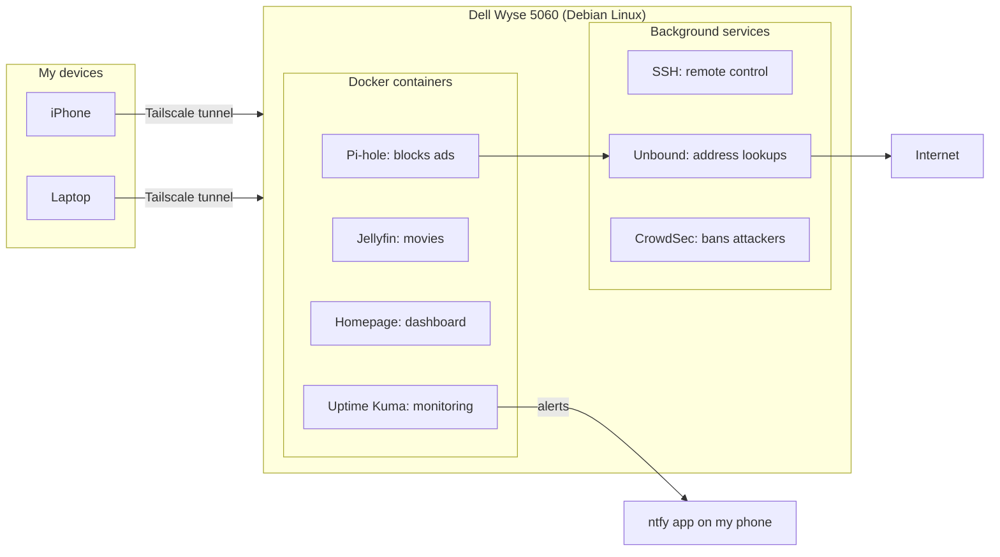

# Alonzo's Homelab

Hey! I'm a cybersecurity student, and this repo documents my homelab: what I build, what breaks, and how I fix it.

> **Beginner disclaimer:** I'm still learning. A lot of this is me figuring things out in real time, making mistakes, and writing down what I learned. If you're a beginner too, I hope this helps. If you're experienced, feedback is welcome.

---

## Why I'm doing this

- Get hands-on with Linux, networking, and security, not just read about them
- Build real experience for a SOC Analyst / GRC career path
- Practice documenting work the way security teams do (incident reports, configs, lessons learned)

---

## Visual: The whole lab at a glance

**Analogy:** The Wyse is a house. My devices reach it through a private tunnel; inside, each program is a room with one job.

## Hardware

| Device | Role |
|---|---|
| Dell Wyse 5060 thin client | Always-on home server (Debian 12) |
| 1.8TB external drive | Extra storage for the server |
| Wall-plug Wi-Fi extender | Gives the Wyse its ethernet connection |
| Gaming PC (Windows) | On the tailnet (client only); future virtual machine lab |
| Laptop | Remote access and study |

---

## What's running on the server

| Service | What it does | Status |
|---|---|---|
| [Pi-hole](pihole.md) | Blocks ads and trackers at the DNS level | ✅ Running in Docker, not yet network-wide |
| [Tailscale](tailscale.md) | Secure remote access to my network from anywhere | ✅ Reaching Pi-hole from my phone anywhere; DNS fixed; exit node working |
| Docker | Runs services in isolated containers | ✅ Running |
| [SSH](ssh-setup.md) | Control the server from my laptop, no monitor needed | ✅ Working from my laptop over Tailscale, key-only (passwords disabled) |
| [Unbound](unbound.md) | My own recursive DNS resolver: Pi-hole asks the internet's root servers directly instead of Google, with DNSSEC validation | ✅ Running, Pi-hole's only upstream |
| [Jellyfin](jellyfin.md) | My own streaming server ("personal Netflix"), reachable from anywhere over Tailscale | ✅ Running, Movies + Shows libraries set up |
| [Homepage](homepage.md) | One dashboard linking every service: live Pi-hole, Uptime Kuma and Jellyfin widgets, status dots, weather, and study links | ✅ Running, purple redesign |
| [Uptime Kuma](uptime-kuma.md) | Checks every service every 60 seconds (web pages and real DNS queries) and shows uptime history | ✅ Running, 4 monitors with phone alerts (fire drill passed) |
| [CrowdSec](crowdsec.md) | Reads SSH logs, detects brute-force attacks, and bans attacker IPs at the firewall (IDS + IPS) | ✅ Running, caught and banned a simulated attack |
| [Dozzle](dozzle.md) | Live logs from every container in one web page, read-only through a socket proxy, login required | ✅ Running |
| [Composio](composio.md) | One connector that links Claude to my apps (GitHub now); school Outlook blocked by admin consent, a least-privilege lesson | ✅ GitHub connected |
| XFCE desktop | Lightweight graphical desktop | ✅ Installed, but the server runs headless (no monitor needed) |

---

## Progress so far

| Date | What I did |
|---|---|
| Oct 25, 2026 | Built my [Resources](resources.md) page: the h4cker folders that fit GRC/SOC, plus classic papers (Saltzer & Schroeder, Trusting Trust, Kill Chain, ATT&CK, 99% False Positives, Gordon-Loeb, NIST 800-61r3, IR 8286) mapped to roadmap levels with a weekly reading order |
| Oct 25, 2026 | Wrote my [career roadmap](grc-consultant-roadmap.md): 6 phases from Security+ to my own consultancy, cert order, and 9 GRC side-quest projects for the lab (inventory, supply-chain audit, CIS/CSF assessment, risk register, policies, BIA/DR, vendor risk, evidence automation, client-style report) |
| Oct 25, 2026 | Built **Audit Ready**, a GRC study game (71 questions: frameworks, risk math, controls, audit evidence commands, privacy laws, and my lab mapped to controls). Documented how my server got here; Debian came pre-installed by the seller, so I flagged it as a supply-chain risk to audit or re-image ([notes](how-my-server-got-here.md)) |
| Oct 25, 2026 | Added a Dozzle tile to the dashboard's Security row; a phone-typed YAML spacing error broke the page, so I restored the backup, measured the real indents with `cat -A`, and inserted the block exactly with `sed` ([notes](homepage.md)) |
| Oct 25, 2026 | Connected Composio to Claude and linked GitHub; STU's admin consent blocked Outlook (app asked for ~12 permissions incl. send-as, I needed 1), so I used the built-in browser instead ([notes](composio.md)) |
| Oct 25, 2026 | Added my gaming PC to Tailscale (exit node kept off; skipped the signature check, so I documented how to verify it after install), confirmed `http://wyse:3000` loads from it, and reviewed the device list ([notes](tailscale.md)) |
| Oct 25, 2026 | Wrote a "verify before you run" habit for Windows installers: official source + code-signing check, with Rainmeter as the real example ([notes](verify-before-you-run.md)) |
| Oct 24, 2026 | Installed Dozzle (live container logs) behind a read-only socket proxy instead of handing it the Docker socket; added a login after the in-app setup silently failed ([notes](dozzle.md)) |
| Oct 24, 2026 | MagicDNS: reach everything by name (`http://wyse:3000`); added the name to Homepage's allowed hosts (DNS-rebinding protection); Lab House added to the dashboard ([notes](tailscale.md)) |
| Oct 24, 2026 | Login screen flagged disk growth (79% → 86%); measured it, removed Discord, Firefox (least functionality) and the apt cache: back to 81% ([log](disk-cleanup-and-ssh-log.md)) |
| Oct 24, 2026 | Custom neofetch logo (AZ + Matrix rain + heart + bat) shown at every login ([notes](ssh-setup.md)) |
| Oct 24, 2026 | Custom purple login screen with live stats (uptime, disk, containers, CrowdSec bans); it immediately flagged the main disk at 86% ([notes](ssh-setup.md)) |
| Oct 24, 2026 | Added an SSH legal warning banner ("Authorized access only"), a GRC control, and verified it from an attacker's view ([notes](ssh-setup.md)) |
| Oct 24, 2026 | Closed CrowdSec's Docker side door (`DOCKER-USER` chain) and proved it with a self-expiring 2-minute ban on my own phone ([notes](crowdsec.md)) |
| Oct 23, 2026 (night) | Redesigned Homepage: purple theme, custom background, weather, status dots, Uptime Kuma widget, Security + Study rows ([notes](homepage.md)) |
| Oct 23, 2026 (night) | Installed CrowdSec + firewall bouncer, fixed it reading a log file Debian 12 doesn't have, then ran a red-team/blue-team drill: my phone brute-forced SSH and got detected (`ssh-bf`) and banned ([notes](crowdsec.md)) |
| Oct 23, 2026 (night) | Installed Uptime Kuma and set up 4 monitors (Pi-hole web, Pi-hole DNS, Jellyfin, Homepage), all from my phone; fixed a self-signed cert failure; push alerts to my phone with ntfy ([notes](uptime-kuma.md)) |
| Oct 23, 2026 (night) | From my phone over SSH: removed 200MB of leftover containerd image data, system drive 82% → 79% ([notes](jellyfin.md)) |
| Oct 23, 2026 (night) | SSH from my iPhone over Tailscale with its own key, so I can manage the server from anywhere ([notes](ssh-setup.md)) |
| Oct 23, 2026 | Built a Homepage dashboard for all my services ([notes](homepage.md)) |
| Oct 22, 2026 (night) | Installed Jellyfin; fixed a `no space left` failure by moving Docker's image storage off the small system drive ([notes](jellyfin.md)) |
| Oct 22, 2026 (night) | Installed Unbound as a private recursive DNS resolver with DNSSEC; Pi-hole now asks it instead of Google ([notes](unbound.md)) |
| Oct 22, 2026 (evening) | Verified the exit node, recovered Pi-hole after it vanished on reboot (Docker started before its drive mounted), made Docker wait for the drive, and got Pi-hole blocking ads for my laptop and phone from anywhere over Tailscale ([log](pihole-docker-recovery-log.md)) |
| Oct 22, 2026 | Shut the Wyse down cleanly for a cable cleanup; it came back headless on its own after reboot (Tailscale green, `allow-hotplug` working) |
| Oct 21, 2026 (night) | Freed disk space from 93% to 81%, set up SSH from my laptop over Tailscale, switched SSH to key-only login, audited every open port, fixed IP forwarding, and switched to `allow-hotplug` ([log](disk-cleanup-and-ssh-log.md)) |
| Oct 21, 2026 | Ran the Wyse headless for the first time, reached Pi-hole from my phone through Tailscale, and fixed a Tailscale DNS setting that broke my phone's internet off the home network ([log](remote-access-log.md)) |
| Oct 21, 2026 | Built a 158-acronym cheat sheet and the Acronym Breach practice game, published with GitHub Pages |
| Oct 21, 2026 | Wrote the SSH setup guide and the Wyse safety net plan |
| Oct 20, 2026 | Recovered the Wyse from a boot failure: emergency mode, no network, no desktop, and a kernel panic ([log](wyse-boot-recovery.md)) |

---

## Logs and write-ups

- [How my server got here](how-my-server-got-here.md): from a $40 used thin client (Debian pre-installed by the seller, a supply-chain risk) to a headless server, with journey, before/after, and network diagrams
- [Wyse boot failure recovery](wyse-boot-recovery.md): fixing emergency mode, network, desktop, and a kernel panic
- [First headless boot + remote access](remote-access-log.md): exit node kill switch, a missing ethernet cable, and reaching Pi-hole from my phone through Tailscale
- [Disk cleanup, SSH, and hardening](disk-cleanup-and-ssh-log.md): finding a 486MB duplicate safely, verifying an SSH fingerprint, key-only SSH, and an open-port audit
- [Pi-hole vanished after reboot + Pi-hole over Tailscale](pihole-docker-recovery-log.md): a Docker boot-order race condition and Pi-hole's listening mode
- [Verify before you run](verify-before-you-run.md): my checklist for confirming an installer is legit (official source, digital signature, UAC publisher, hash)
- [Wyse safety net](wyse-safety-net.md): production rules and how to set up (and undo) every safety net before running Pi-hole for the whole house

---

## Study tools

- [Acronyms cheat sheet](acronyms.md): 158 Security+ and homelab acronyms with plain-English meanings
- [Know Your Lab](https://alonzogreen0304.github.io/Homelab/games/know-your-lab.html): Learn cards (simple explanation + analogy + where it is in my lab) and a 37-question quiz on everything I've built ([source](games/know-your-lab.html))
- [Wyse Labs](https://alonzogreen0304.github.io/Homelab/games/labs.html): 8 hands-on practice labs I run on my own server, TryHackMe-style: Linux Detective, Log Hunter, DNS Lab, Know Your Doors (ports), Attack & Detect (CrowdSec), Incident Response Drill (MTTD/MTTR), Hardening Audit (Lynis, GRC), and Vulnerability Scan (Trivy). Each has a goal, analogy, step flow, commands, answer checks, and a Security+ debrief ([source](games/labs.html))
- [Lab House](https://alonzogreen0304.github.io/Homelab/games/lab-house.html): a beginner study guide to my whole lab, explained as a house. Starts with "what is a homelab / server / port", then every underlined term (DNS, VPN, IDS, etc.) is tappable with a plain meaning and a real example, plus a deep-dive on hardware, operating systems, Linux, what a package manager is and where programs come from, and what programs/services/containers are, and a 51-term A-Z glossary. Tap a room (mail sorter = Pi-hole, camera guard = CrowdSec, etc.) for an animation, what it does, how it's set up in my lab, and the security idea behind it. Includes a guided tour and a "follow a website visit" mode ([source](games/lab-house.html))
- [Public Wi-Fi Reality Check](https://alonzogreen0304.github.io/Homelab/games/wifi-check.html): a 5-stop walkthrough I show friends: what public Wi-Fi can and can't see (HTTPS envelope), a tracker-count simulation with a Pi-hole on/off switch, spot-the-fake-hotspot (evil twin), how to check your own phone's App Privacy Report, and a 2-minute iPhone/Android privacy fix ([source](games/wifi-check.html))
- [Audit Ready](https://alonzogreen0304.github.io/Homelab/games/audit-ready.html): a GRC game set up like an audit case file. 71 questions across Frameworks (NIST CSF 2.0, ISO 27001, SOC 2, RMF, PCI DSS, CMMC), Risk (SLE/ALE, treatments, appetite), Controls, Policy & Audit (RPO/RTO, BIA, vendor risk), Evidence Commands (what to run when an auditor asks), Laws & Privacy (GDPR, HIPAA, FERPA, SOX), and My Lab (my own setup mapped to controls). Each answer gets a COMPLIANT or FINDING stamp, the why, and an analogy. 3 findings fails the audit; XP ranks from Intern to CISO; plus a Field Guide to study from ([source](games/audit-ready.html))
- [Command Center](https://alonzogreen0304.github.io/Homelab/games/command-center.html): every command from my lab (51 of them). **Learn** cards (what it does, analogy, where I used it, flag-by-flag breakdown), a **Quiz** (what does it do, which command, and 20 "what we did" troubleshooting scenarios), and **Type It**, where I type commands from memory. Tracks XP, streaks, and per-command mastery ([source](games/command-center.html))
- [Acronym Breach](https://alonzogreen0304.github.io/Homelab/games/acronym-breach.html): a terminal-style hacker game for drilling them. Play it in the browser, or add it to your phone's home screen ([source](games/acronym-breach.html))

---

## Roadmap

**Reading list:** [Resources](resources.md): h4cker folders and research papers, mapped to my roadmap levels.

**Career roadmap:** [visual map](https://alonzogreen0304.github.io/Homelab/games/roadmap.html) · [written version](grc-consultant-roadmap.md): phases, certs, and 9 GRC projects that turn this lab into audit practice.

**Homelab to-dos:**

- [ ] Point my router's DNS at Pi-hole so every device gets ad blocking
- [x] Free up space on the Wyse's drive (93% → 81%)
- [x] Fix IP forwarding
- [x] Approve and test the Wyse as an exit node (ISP flips from T-Mobile to Comcast)
- [x] Switch the network config to `allow-hotplug` (survived a full power-down and reboot)
- [x] Pi-hole ad blocking on my laptop and phone from anywhere, over Tailscale
- [ ] Change the weak Pi-hole web password
- [x] Review Tailscale devices (old iPhones reconnected and in use)
- [x] Reach the server remotely through Tailscale
- [x] Run the server headless (no monitor needed)
- [x] Set up SSH from my laptop
- [x] Switch SSH to key-based login and disable passwords
- [x] SSH from my phone with its own key
- [x] Audit open ports (OpenClaw gateway is localhost-only)
- [x] Set up Unbound (recursive DNS + DNSSEC)
- [ ] Second Pi-hole on another always-on device, synced with nebula-sync
- [x] Install Jellyfin
- [x] Reclaim old containerd image data on the internal drive (203M → 668K)
- [x] Homepage dashboard
- [x] Uptime monitoring (Uptime Kuma)
- [x] Phone push alerts when a service goes down (ntfy)
- [x] Intrusion detection + prevention (CrowdSec)
- [ ] Auto power-on after outages: BIOS AC Recovery → Power On ([safety net 4](wyse-safety-net.md))
- [ ] Wyse + extender on the APC UPS battery outlets; later `apcupsd` for clean shutdowns ([safety net 7](wyse-safety-net.md))
- [ ] AI SOC analyst: nightly read-only Claude briefing of CrowdSec / Uptime Kuma / disk status pushed to my phone via ntfy (locked-down user, key in `chmod 600`, logs treated as untrusted for prompt injection)
- [x] CrowdSec `DOCKER-USER` fix + re-test: bans now block containers too ([notes](crowdsec.md))
- [x] Find what grew the main disk from 79% to 86% (spotted by the new login screen): new programs; removed Discord + Firefox, 86% → 81%
- [ ] Build a VM lab on my PC (Kali, Ubuntu, Windows Server, Wazuh SIEM)
- [ ] Audit the homelab against NIST CSF / CIS Controls

---

## Security note

Private details like internal IPs, device IDs, and account info are intentionally left out of this repo.
