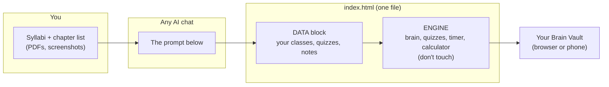

# Brain Vault: a 3D study hub for your classes

**[Open the live demo](https://alonzogreen0304.github.io/Homelab/brain-vault/)** (sample data)

I built this for my own semester: a spinning 3D brain where every lobe is one of my classes. Tap a lobe and you get that class's due dates, chapter notes, quizzes, flashcards, timed practice exams, and hands-on labs. The version on GitHub is a **template with fake demo classes**. My real one, with my grades, stays private.

You can make your own in about an hour by giving your syllabi to any AI (Claude, ChatGPT, Gemini) and pasting what it gives you back into one file.

**Analogy:** the brain is the building, each lobe is a classroom, and the tabs inside are the notebook, the practice tests, and the lab bench.

---

## What it does

| Feature | What you get |
|---|---|
| 3D brain | Drag to spin, tap a lobe to open that class. Lobes with something due in 3 days or less pulse |
| Next up + countdowns | The 3 nearest deadlines across all classes, plus a day counter on every class |
| Overview | Grade, what's due, how the grade is weighted, key ideas, your class rules |
| Grade calculator | "What do I need on the final?" and "If I score X, what do I end with?" |
| Study guide | Tap a chapter: summary, key terms, worked example, exam traps, analogy |
| Chapter quizzes | Multiple choice, with the "why" after every answer. Best scores saved |
| Weak spots | Every question you miss is saved. "Drill my weak spots" quizzes you on only those until you get them right |
| Flashcards | Every key term, tap to flip, shuffle |
| Practice exams | Timed, no answers until the end, like the real thing |
| Class test + Brain test | Random questions from one class, or from every class at once |
| Hands-on labs | Optional step-by-step labs with a "did it" checkbox |

Everything runs in one HTML file, with no server, no account, and no outside libraries. Progress saves in your browser.

---

## How it fits together



The file has two parts:

- **DATA:** everything between `YOUR DATA START` and `YOUR DATA END`. This is the only part you change.
- **ENGINE:** everything below that. It reads your data and builds the whole page.

**Analogy:** the engine is a game console and the data block is the cartridge. Swap the cartridge, and you get a different game on the same console.

---

## Build your own (step by step)

1. **Download** [`index.html`](index.html). On GitHub, open it and click the download (raw) button.
2. **Gather your class info:** syllabus, grading weights, due dates, and the chapter or module list for each class.
3. **Open an AI chat**, paste the [prompt below](#the-prompt), and attach your syllabi.
4. **Get the DATA block back.** The AI gives you one code block that starts with `// ===================== YOUR DATA START` and ends with `// ===================== YOUR DATA END =====================`.
5. **Swap it in.** Open `index.html` in any text editor (Notepad works), select everything from `YOUR DATA START` to `YOUR DATA END`, and paste the new block over it.
6. **Open the file** in your browser. On your phone, put it in Google Drive, iCloud, or your own GitHub Pages.
7. **Add more over time:** "Write 5 more quiz questions for chapter 4 in the same format" works great.

**If the page goes blank:** the AI probably broke the format. Paste the browser's error (right-click → Inspect → Console) back into the chat and ask it to fix the DATA block.

---

## The prompt

Copy this into your AI, attach your syllabi, and fill in the brackets:

```text
I'm using a study app called Brain Vault. Build me its DATA block, a JavaScript
code block, for my classes. Follow this format exactly, and only output the code.

My classes: [list them, or say "see attached syllabi"]
Term: [e.g. Spring 2027]

Rules:
- Start with: // ===================== YOUR DATA START =====================
- End with:   // ===================== YOUR DATA END =====================
- Define, in this order: TERM, CLASSES, ORDER, STUDY, CH, GUIDE, LABS, EXAMS
- TERM = { title, year, asof, labsNote }
- CLASSES[key] = { code, name, lobe, slot, color, why, meta, grade, letter,
  status ("good" | "warn" | "bad" | "na"), note, due: [[date, text]],
  weights: [[name, percent]], key: [short ideas], rule }
  - slot must be one of: frontal, parietal, temporal, occipital, cerebellum, stem, motor
    (one class per slot, 7 max). "why" = one sentence on why that brain region fits the class.
  - dates: "YYYY-MM-DD" or "Nov 3". Anything else (like "Weekly") still shows, just without a countdown.
- ORDER = array of class keys
- STUDY[key] = { linksTitle, rows: [[term, plain English, analogy]], tips: [], links: [[name, url]] }
  Optional: career: [[title, description, in practice]]
- CH[key] = array of chapters: { t: "Ch 1 · Title", q: [[question, [CORRECT, wrong, wrong, wrong], why]] }
  The correct answer is ALWAYS first in the array. Write 4-6 questions per chapter,
  with believable wrong answers.
- GUIDE[key] = same number of chapters as CH[key], same order:
  { o: summary, k: [[term, definition]], x: worked example, tr: [exam traps], an: analogy }
- LABS = optional hands-on labs: LABS[key] = [{ t, ch, tags: [], why, steps: [], check }]
- EXAMS = optional timed exams: EXAMS[key] = [{ t, ch: [chapter indexes, 0 = first], n: questions, min: minutes }]
- Only use facts from my syllabus and standard textbook knowledge. Don't make up due dates.
- Use plain double quotes and escape any quotes inside strings.
```

---

## Field cheat sheet

| Field | Example | Notes |
|---|---|---|
| `slot` | `"cerebellum"` | Which part of the brain lights up. Unused regions stay gray |
| `color` | `"#4da3ff"` | Any hex color. Pick bright ones; the background is dark |
| `status` | `"warn"` | Colors the status pill: good = green, warn = yellow, bad = red, na = gray |
| `due` | `[["2026-11-03", "Quiz 2"]]` | Real dates get a countdown. Dates within 3 days glow red |
| `weights` | `[["Final", 30]]` | Anything with "final" in the name turns on the grade calculator |
| `CH` question | `["2 + 2?", ["4", "3", "5", "22"], "Basic math."]` | Correct answer first. The app shuffles them |
| `EXAMS.ch` | `[0, 1, 2]` | Chapter numbers start at 0 |

### Brain regions

| Slot | Where it is | Good fit for |
|---|---|---|
| `frontal` | Front of the brain | Strategy, planning, capstone classes |
| `parietal` | Top-back | Math, economics, stats |
| `temporal` | Sides | Languages, programming |
| `occipital` | Back | Design, vision, entrepreneurship |
| `cerebellum` | Bottom-back | Hands-on, labs, IT |
| `stem` | Bottom | The class that needs the most attention |
| `motor` | Strip across the top | Certifications and skills (Security+, etc.) |

---

## Use AI the right way

This is a **study** tool. Let the AI explain concepts, write practice questions, and make notes. **Don't** use it to do graded work, and check your class's AI policy. Most allow brainstorming and studying, and most ban AI-written submissions. **No AI during real quizzes or exams.**

Double-check AI-written questions against your textbook. AI is good, but it's not your professor.

## Privacy

If you post your own version publicly (GitHub Pages is public), leave out your grades, professor names, and anything personal. Keep the real one private: on your device, in a private repo, or in a private AI artifact.

---

Built by [Alonzo](https://github.com/alonzogreen0304) as part of my [homelab](../README.md). Made with help from Claude.
