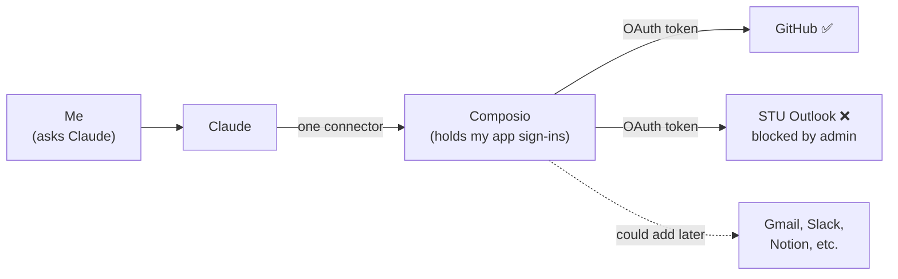
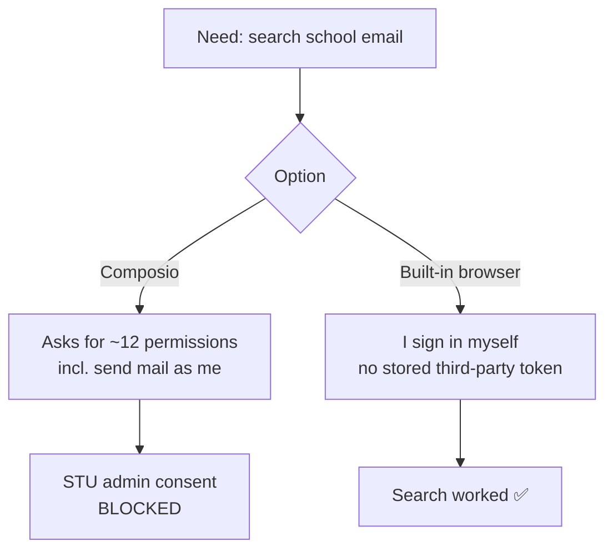

# Composio: one plug for all my apps

**Date:** Oct 25, 2026
**Status:** Connected to Claude as a custom connector. GitHub works. Outlook (school) is blocked by STU IT.

---

## What it is (simple terms)

Composio is a service that sits between an AI (like Claude) and my apps (GitHub, Outlook, Gmail, Slack, and hundreds more).

- I connect each app to Composio once, by signing in.
- Composio stores that sign-in (an OAuth token) for me.
- Claude talks to Composio, and Composio does the work in the app.

So Claude doesn't need a separate connector for every app. It needs one: Composio.

> **Analogy:** Composio is a **universal remote**. Instead of a pile of remotes (one per TV, soundbar, and cable box), I pair every device to one remote once. Claude just presses buttons on that one remote.
>
> Second analogy, for the security side: it's a **valet with a key ring**. I hand the valet my keys, and the valet drives the cars for me. That's convenient, but now the valet holds every key, so I need to trust the valet.

---

## Visual: how a request flows

---

## What GitHub through Composio does for me

It lets Claude work with my GitHub from **any** Claude chat, including on my phone, without me setting anything else up:

- Read my repos and files (like this Homelab repo)
- Create issues (to-do items for the lab)
- Open pull requests, comment, and check activity

> **Analogy:** before this, Claude could only work on my repo from one workshop (a coding session with the repo already cloned). Now Claude has a **spare key to the garage** and can get in from any chat.

---

## The security lesson: STU blocked Outlook (good!)

When I tried to connect my school Outlook, Microsoft showed **"Approval required."** Composio asked for a lot:

| Permission asked | Did I need it to search for internship emails? |
|---|---|
| Read user mail | ✅ Yes |
| Read **and write** user mail | ❌ No |
| **Send mail as a user** | ❌ No |
| Full access to calendars and contacts | ❌ No |
| Read/write chat messages and mailbox settings | ❌ No |
| Keep access to data I've given it | ❌ No (it stays on until I revoke it) |

I needed **one** permission, and it asked for about **twelve**. That breaks **least privilege** (only give the minimum access needed). STU's IT requires admin approval for outside apps, which is a control called **admin consent**. It's a normal policy in Microsoft 365 schools and companies, and it stopped this.

> **Analogy:** I asked to borrow the key to one mailbox, and the app asked for the **master key to the whole building**. The front desk (IT) said no. That's the front desk doing its job.

**What I did instead:** I signed in to Outlook myself in Claude's built-in browser. No third party holds a token, and access ends when I sign out.

---

## Risks to keep in mind (GRC view)

- **Third-party risk:** Composio sits in the middle, so it can see what flows through it. Every new app I add is another key on its ring.
- **Token storage:** if Composio got breached, connected tokens could be abused.
- **Over-permissioning:** always read the permission list before clicking Accept.

## How to check or revoke access

- **GitHub:** go to github.com → Settings → Applications → **Authorized OAuth Apps**. Composio should be listed with what it can access. Click **Revoke** to cut it off.
- **Composio:** remove an app from the Composio dashboard's connected apps.
- **Claude:** go to Settings → Connectors and remove or disable Composio.

> **Analogy:** revoking a token is **changing the locks**. The old key stops working right away, even if someone copied it.

---

## Interview talking point

"I connected an AI agent to my apps through Composio. When I tried my school email, Microsoft's admin-consent policy blocked it because the app requested send-as and full mailbox access when I only needed read. I picked a lower-risk path instead. It was a real example of least privilege and third-party risk."
