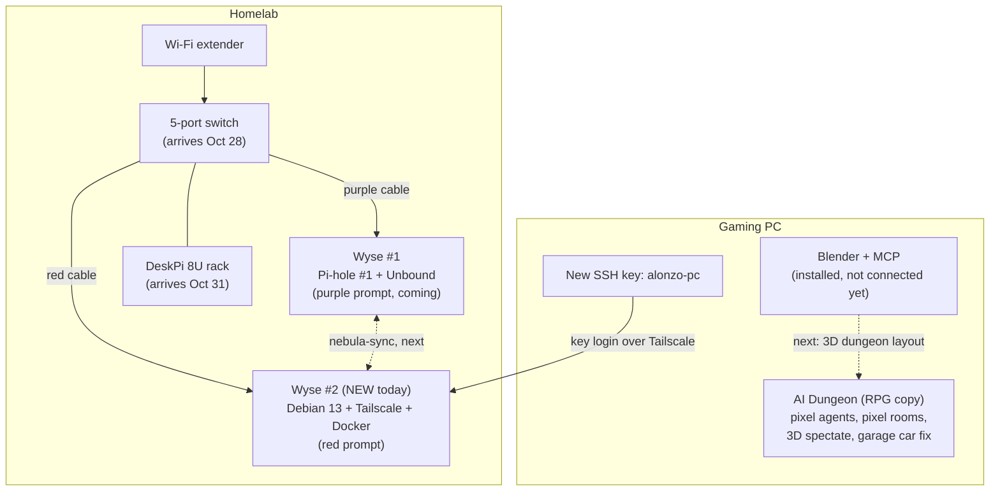

# Daily Log: Oct 27, 2026

Everything I worked on today (plus last night's Brain Vault push), written three ways: the **tech version**, the **simple version**, and the **analogy version**.

---

## 1. Tech version

### Homelab: Wyse #2 (backup Pi-hole)
- **Hardware check:** Wyse #2 arrived running **Windows Embedded Standard 7** (seller's install, no updates since 2020). Decided to wipe it instead of using it.
- **USB installer:** found my SanDisk Ultra 32GB on Wyse #1 as `sdc1`. `lsblk` showed a blank MOUNTPOINT, so it was safe to pull. Flashed **Debian 13.7 netinst** with **Rufus 4.15** (ISO mode, let Rufus download the matching GRUB 2.12 files).
- **BIOS (Phoenix SecureCore, Del key):** USB wasn't in the boot menu because **Boot From USB = Disabled**. Enabled it. Also turned on **Power Loss Recovery** and disabled **Wireless LAN + Bluetooth** to shrink the attack surface.
- **Install:** Guided, entire disk on `sda` (16GB SATA), **not** encrypted LVM (a headless server can't type a boot password). No desktop: only SSH server + standard utilities. Hostname `AZWyse2`, user `me`.
- **Post-install fixes:**
  - `curl: (1) Protocol "https" not supported`: `curl -V` showed https was supported, so the bad part was the typed URL. Fixed by leaving out `https://` and letting `-L` follow the redirect.
  - `wget -q0` failed: the flag is a capital letter **O** (`-qO-`), not a zero.
  - `Could not resolve host` right after `tailscale up`: Tailscale pushed DNS = Pi-hole #1, which was offline because I'd borrowed its cable. Fixed with `sudo tailscale set --accept-dns=false`. A DNS server shouldn't depend on another DNS server.
- **Results:** Tailscale linked (`azwyse2`), Docker installed (`hello-world` passed), a new **ed25519 key** made on my PC (`alonzo-pc`), key-only SSH login working over Tailscale, and a **red prompt** on Wyse #2 (purple planned for Wyse #1).
- **Gear ordered:** a 5-port switch plus purple + red Cat6A 1ft patch cables (Oct 28), the DeskPi 8U rack (Oct 31), and then the rack shelf + 7.84" touchscreen once the OptiPlex was locked in.
- **OptiPlex found:** Dell OptiPlex 3050 **Micro (MFF)**, i5-6500T, **2x8GB = 16GB**, 256GB SSD, 90W charger, HDMI. Local Marketplace seller with good reviews, picking up Oct 28 morning (cash after watching it boot). Passed on a Pentium N3700, an NM70 board, and an overpriced ProDesk 400 G2.
- Full details: [Wyse #2 setup log](wyse2-setup-log.md).

### AI Dungeon (my multi-agent dashboard, on my PC)
- Built an **RPG-themed copy** (`index-v2.html` + `*-v2` files) and left the original files untouched.
- **Agents:** DiceBear pixel-art portraits (CC0) became **walking pixel sprites**. Each body is drawn on the same 16-pixel grid as the face, so skin tone and shirt color match each agent's room color.
- **Rooms and hallways:** pixel-art brick walls, stone floors and torches drawn in code (SVG tiles), with a flicker effect.
- **3D spectate mode:** a Three.js view where you click an agent and watch it inside a 3D room (it walks to its desk when working, paces when blocked, hops when earning), plus a hallway view.
- **Garage car bug:** the header "drift car" didn't update after a paint or mod change, because it was only drawn once at page load. Fixed in the copy by syncing it every time the garage car re-renders.
- **Still to do:** a security patch for the dungeon's local web server.

### Blender
- Set up **Blender MCP** so Claude can build 3D scenes. It's installed, but the add-on still has to be **connected inside Blender** (N panel → MCP tab → Connect) before the full 3D dungeon layout can be built. Paused for now.

### Last night: Brain Vault
- My private study hub got a **2D canvas brain** (no CDN), real study guides, quizzes, flashcards, exam mode, weak spots, countdowns, a grade calculator and a **Security+ lobe**.
- Published a **public template with sample data** (no grades or school info) in [brain-vault/](brain-vault/README.md) so anyone can build their own with AI.

---

## 2. Simple version

- **New server is alive.** My second mini PC came with an ancient version of Windows. I erased it and put Linux on it. It's now on my private network and ready to run apps.
- **Hit 4 bumps and fixed all of them:** USB booting was switched off in the settings, two typing mistakes, and one "it can't find the internet" problem caused by the first server being unplugged.
- **Logging in is safer.** My PC now uses a digital key instead of a password to get into the new server.
- **Color-coded:** the new server's prompt is red, and the old one will be purple, so I always know which one I'm on.
- **Gear is on the way:** a switch and cables tomorrow, the rack on Saturday.
- **Dungeon got a glow-up:** pixel characters that walk around, pixel dungeon rooms, a 3D "watch my agent" mode, and the car now updates when I change it.
- **Blender:** set up, waiting on one connect button.

---

## 3. Analogy version

- **Wyse #2 = hiring a second bouncer.** He showed up wearing a 2010 uniform (Windows 7), so I gave him a fresh one (Debian). Pi-hole #1 is the bouncer at the club door. If he takes a break, the second bouncer keeps the door covered.
- **The BIOS USB setting = a locked side door.** The installer couldn't get in until I unlocked it. Leaving the Wi-Fi and Bluetooth radios off is like keeping the windows I never use locked.
- **The DNS bug = calling an operator whose phone is unplugged.** The new server kept asking Pi-hole #1 for directions while #1 was offline. Now it uses its own phone book.
- **SSH key = a house key instead of a door code.** Anyone can guess a code. Only my PC holds the key.
- **The switch = a power strip for internet.** One cable in from the extender, and it splits out to both servers.
- **Red and purple prompts = color-coded keys** so I never open the wrong door.
- **Dungeon = a video game version of my AI team.** Today they got real character sprites, a castle to walk around in, and a security camera (spectate mode) so I can watch them work.
- **Blender = hiring an architect** to build the full 3D castle. He's hired, I just have to let him in the building (click Connect).

---

## Next up
- [ ] Switch + cables (Oct 28): wire both Wysés, DHCP reservation for Wyse #2
- [ ] Pi-hole #2 + Unbound + nebula-sync
- [ ] Turn off password SSH on Wyse #2, add the Termius phone key, purple prompt on Wyse #1
- [ ] Mount everything in the DeskPi rack (Oct 31)
- [ ] Connect Blender MCP, then build the 3D dungeon layout
- [ ] Turn Boot From USB back off on Wyse #2 after the OptiPlex install
