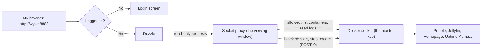

# Dozzle: Live Container Logs

**Beginner level:** still learning, documenting as I go.
**Set up:** Oct 24, 2026, entirely from my phone

## What it is (simple version)

Dozzle is a web page that shows the **live logs of every container** on the Wyse in one place: Pi-hole answering lookups, Uptime Kuma's checks, Jellyfin, Homepage. I can watch them scroll, search, and filter.

**Analogy:** a control room with a wall of security monitors, one for every room in the house.

## Visual: how Dozzle sees the logs without the master key

**Analogy:** instead of handing the camera operator the building's master key (the Docker socket), I gave him a viewing window (a socket proxy). He can watch every room, but he can't open, close, or move anything.



## Why the socket proxy matters

To read container logs, Dozzle needs the **Docker socket** (`/var/run/docker.sock`). Whoever holds the socket can start, stop, or create **any** container. That's basically admin over the whole server. If Dozzle were ever hacked, the attacker would get that power too.

So I put **[docker-socket-proxy](https://github.com/Tecnativa/docker-socket-proxy)** in between. It only allows the read-only parts Dozzle needs:

| Setting | Meaning |
|---|---|
| `CONTAINERS: 1` | Allowed to list containers and read their logs |
| `INFO: 1` | Allowed to read basic Docker info |
| `EVENTS: 1` | Allowed to see when containers start/stop |
| `POST: 0` | **Not allowed to change anything** |

That's **least privilege**. Dozzle's own setup page suggests mounting the socket directly. I didn't.

## Install

```bash
sudo mkdir -p /opt/dozzle /mnt/agents/dozzle
sudo tee /opt/dozzle/docker-compose.yml > /dev/null <<'EOF'
services:
  socket-proxy:
    image: tecnativa/docker-socket-proxy:latest
    container_name: dozzle-socket-proxy
    restart: unless-stopped
    environment:
      CONTAINERS: 1
      INFO: 1
      EVENTS: 1
      POST: 0
    volumes:
      - /var/run/docker.sock:/var/run/docker.sock:ro
  dozzle:
    image: amir20/dozzle:latest
    container_name: dozzle
    restart: unless-stopped
    depends_on:
      - socket-proxy
    environment:
      DOCKER_HOST: tcp://socket-proxy:2375
      DOZZLE_AUTH_PROVIDER: simple
    volumes:
      - /mnt/agents/dozzle:/data
    ports:
      - "8888:8080"
EOF
cd /opt/dozzle && sudo docker compose up -d
```

Checked memory first (`free -h`: 1.4Gi available). Dozzle + the proxy use about 40MB total.

## Adding a login

Dozzle warned: **"Anyone who can reach Dozzle can read your logs."** Logs can contain IPs and usernames, so I added a login.

**Analogy:** a notebook for the guest list (`/data` on the big drive), a key (the account), and a lock on the door (`DOZZLE_AUTH_PROVIDER: simple`). It needed all three.

1. **The notebook:** mounted `/mnt/agents/dozzle` as `/data`, so the account survives restarts.
2. **The key:** the in-app "Create account" didn't save (the folder was still empty), and Dozzle only allows setup changes in the **first 15 minutes** without a login. So I generated the account from the terminal:
   ```bash
    sudo docker run --rm amir20/dozzle generate Az --password '<password>' --name 'Az' | sudo tee /mnt/agents/dozzle/users.yml > /dev/null
   ```
   (Leading space keeps the password out of bash history. The password is stored **hashed**, not plain text.)
3. **The lock:** added `DOZZLE_AUTH_PROVIDER: simple` and re-created the container with `up -d`.

Result: `http://wyse:8888` now shows a login screen first.

## Security concepts

| Concept | Where it shows up |
|---|---|
| **Least privilege** | Socket proxy: read-only, `POST: 0` |
| **Defense in depth** | Proxy blocks changes, Dozzle's "Actions and shell" stays off, login required, only reachable over Tailscale |
| **Authentication** | Login before anyone sees logs |
| **Hashing** | Password stored scrambled one-way in `users.yml` |
| **Verify, don't assume** | The app said the account was created; `ls` proved it wasn't |

## Next steps

- [ ] Add Dozzle to Homepage and an Uptime Kuma monitor
- [ ] Practice: find Pi-hole blocking an ad and CrowdSec reading SSH logs, live
