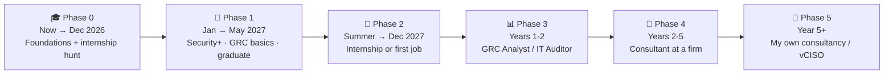
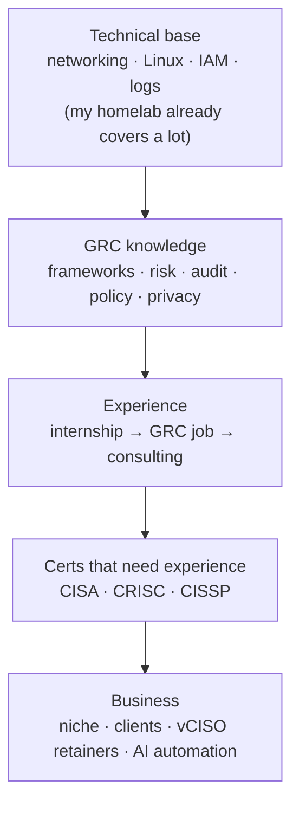
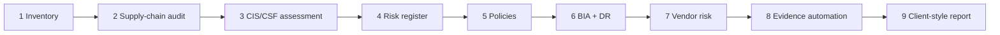

# My Roadmap: GRC → Consultant → My Own Firm

**Started:** Oct 25, 2026 · senior at St. Thomas University, Class of 2027
**Goal:** land a GRC role, become a cybersecurity consultant, then run my own consulting business (with AI automation as my edge).

> **Analogy:** this roadmap is a video game campaign. Each phase is a level: you learn new skills (study), earn badges (certs), beat side quests that prove it (homelab projects), and unlock the next map (a job). You can't skip to the final boss, but every level makes the next one easier.

---

## Visual: the whole path

## Visual: what each phase builds on

---

## Phase 0: Now → Dec 2026 (foundations + internship hunt)

| Track | To do |
|---|---|
| **Study** | Security+ SY0-701 (all 5 domains). Use [Audit Ready](https://alonzogreen0304.github.io/Homelab/games/audit-ready.html), [Acronym Breach](https://alonzogreen0304.github.io/Homelab/games/acronym-breach.html), and [Command Center](https://alonzogreen0304.github.io/Homelab/games/command-center.html) daily |
| **Career** | Apply to Summer 2027 internships now (GRC, IT audit, compliance, SOC). Use Handshake, LinkedIn, and Angela Hernandez (STU career services). Targets like Coalfire Compliance Advisory and Hunter Strategy GRC |
| **Homelab (GRC)** | **Project 1:** asset inventory. **Project 2:** supply-chain audit of the pre-installed Debian (see the project list below) |
| **Profile** | LinkedIn: headline "Cybersecurity student · GRC & SOC · Homelab", plus a GitHub link. Resume has a Homelab section with real numbers |

## Phase 1: Jan → May 2027 (Security+, GRC basics, graduate)

| Track | To do |
|---|---|
| **Cert** | **Pass Security+** (target: Feb or Mar 2027) |
| **Study** | NIST CSF 2.0 (6 functions), CIS Controls v8 (IG1), NIST SP 800-53 families, ISO 27001 basics, SOC 2 (Type I vs II), risk math (SLE/ALE) |
| **Homelab (GRC)** | **Project 3:** CIS IG1 / NIST CSF self-assessment. **Project 4:** risk register |
| **Skills** | Excel (pivot tables, XLOOKUP): GRC runs on spreadsheets. Writing short, clear reports |
| **Career** | Lock in the internship. Go to local events: ISACA Miami, ISC2 South Florida, and BSides. Graduate |

## Phase 2: Summer → Dec 2027 (internship or first job)

| Track | To do |
|---|---|
| **Career** | Internship, then convert it to a full-time job, or apply for entry-level roles: GRC Analyst, IT Audit Associate, Compliance Analyst, Junior Risk Analyst, SOC Analyst |
| **Cert (optional)** | ISO 27001 Foundation, or Lead Implementer (no experience needed) |
| **Homelab (GRC)** | **Project 5:** policy pack. **Project 6:** BIA + DR plan with a real restore test |
| **Study** | Privacy laws (GDPR, HIPAA, FERPA, state laws), cloud shared responsibility (AWS/Azure basics) |

## Phase 3: Years 1-2 on the job (GRC Analyst / IT Auditor)

| Track | To do |
|---|---|
| **Job** | Collect evidence, run control testing, track risks, do vendor reviews, support SOC 2 / ISO audits |
| **Certs** | **CISA** (ISACA, audit) or **ISC2 CGRC**. You can pass exams before you have the full experience, and certify once you do |
| **Tools to learn** | Vanta, Drata, ServiceNow GRC, Archer or OneTrust (whatever the job uses) |
| **Homelab (GRC)** | **Project 7:** vendor risk assessments. **Project 8:** evidence-collection automation |
| **Network** | Join ISACA and ISC2. Post what I learn on LinkedIn |

## Phase 4: Years 2-5 (consultant at a firm)

| Track | To do |
|---|---|
| **Job** | Move to consulting: Big 4 (Deloitte, PwC, EY, KPMG), Coalfire, Optiv, A-LIGN, Schellman, or a boutique. Learn to run client projects, write reports, and present to executives |
| **Certs** | **CRISC** (risk) and/or **CISSP** (the big one). Optional: ISO 27001 Lead Auditor, CMMC assessor |
| **Pick a niche** | Industry + problem, e.g. "SOC 2 readiness for startups" or "HIPAA for South Florida clinics" |
| **Side work** | Small gigs, with my employer's OK and no conflict of interest |
| **Homelab (GRC)** | **Project 9:** mock client engagement report |

## Phase 5: Year 5+ (my own consultancy)

| Track | To do |
|---|---|
| **Business setup** | LLC, professional liability (E&O) + cyber insurance, solid contracts. Talk to a lawyer and an accountant |
| **Offer** | Productized packages (e.g. "SOC 2 readiness in 90 days") + **vCISO retainers** (monthly part-time security leader) |
| **First clients** | Old coworkers and bosses, subcontracting for bigger firms, local businesses with compliance needs |
| **Edge** | **AI automation:** evidence collection, policy drafts, control tracking, so one person can serve more clients |

> **Analogy:** a chef going solo. First you cook in other people's restaurants and build a name (Phases 2-4). Then you cater one specialty dish (your niche). Eventually clients are on a weekly meal plan (retainers) instead of you hustling for every single order.

---

## Homelab GRC projects (the side quests)

My homelab so far is mostly the **technical** side: building and securing services. These projects add the **GRC** side, treating my lab like a real client. Each one becomes a GitHub write-up and an interview story.

| # | Project | What I make | GRC skill it proves | Phase |
|---|---|---|---|---|
| 1 | **Asset inventory** | Table of hardware, OS, services, containers, ports, owners | CIS Controls 1 & 2 (you can't protect what you don't know) | 0 |
| 2 | **Supply-chain audit** of the pre-installed Debian | Check users, sudoers, SSH keys, cron, services, and decide: re-image or accept | Third-party/supply-chain risk, evidence collection | 0 |
| 3 | **CIS IG1 / NIST CSF 2.0 self-assessment** | Scorecard: met / partial / not met, plus a gap report | Gap assessment, framework mapping | 1 |
| 4 | **Risk register** | Risks scored likelihood × impact, owner, treatment, POA&M (e.g. one Wyse = single point of failure, UPS not wired, weak Pi-hole password) | Risk management | 1 |
| 5 | **Policy pack** | Acceptable Use, Access Control, Change Management (lessons from the YAML incident), Backup, Incident Response | Policy writing (policy → standard → procedure) | 2 |
| 6 | **BIA + DR plan** | RTO/RPO per service, backup plan, and a real restore test | Business continuity / disaster recovery | 2 |
| 7 | **Vendor risk assessments** | Short reviews of Tailscale, Composio, and Docker Hub images (permissions, data, SOC 2 reports) | Third-party risk management | 3 |
| 8 | **Evidence automation** | Script that collects audit evidence (users, ports, patches, SSH config) into a dated report | Continuous monitoring + AI automation (my business edge) | 3 |
| 9 | **Mock client engagement** | A consulting-style report: executive summary, findings, risk ratings, roadmap | Consulting deliverables | 4 |

> **Analogy:** so far I built the house and installed the locks (technical). Now I become the **inspector** of my own house: list every room, check every lock against the code book, write down what's risky, and hand myself a report like a real client would get.

---

## Everything to learn (checklist)

**Technical base** (homelab already covers a lot)
- [x] Linux command line, SSH, permissions
- [x] Networking: DNS, ports, VPN (Tailscale), firewalls
- [x] Logging and monitoring (Uptime Kuma, Dozzle, CrowdSec)
- [ ] Identity and access management (IAM, MFA, SSO concepts)
- [ ] Cloud basics + shared responsibility model
- [ ] Windows / Active Directory basics (VM lab on the gaming PC)

**GRC core**
- [ ] NIST CSF 2.0 · NIST SP 800-53 · NIST RMF (800-37)
- [ ] ISO 27001 / 27002
- [ ] SOC 2 (Trust Services Criteria)
- [ ] CIS Controls v8
- [ ] PCI DSS 4.0 · HIPAA · GDPR · FERPA · SOX · CMMC basics
- [ ] Risk assessment (qualitative + quantitative), risk register, treatments
- [ ] Control testing and evidence collection
- [ ] Policy writing
- [ ] Vendor / third-party risk
- [ ] BIA, BC/DR, incident response planning

**Consultant + business skills**
- [ ] Clear writing: short reports and executive summaries
- [ ] Presenting to non-technical people
- [ ] Excel / spreadsheets
- [ ] Project management basics (scope, timeline, deliverables)
- [ ] Sales basics: niche, offer, pricing, proposals
- [ ] Business basics: LLC, contracts, insurance

## Certs, in order

| Cert | From | When | Experience needed? |
|---|---|---|---|
| **Security+** | CompTIA | Phase 1 | No |
| ISO 27001 Foundation / Lead Implementer | PECB / others | Phase 2 (optional) | No |
| **CISA** (audit) or **CGRC** (governance) | ISACA / ISC2 | Phase 3 | Yes, but you can pass the exam first and certify later |
| **CRISC** (risk) | ISACA | Phase 4 | Yes |
| **CISSP** | ISC2 | Phase 4 | Yes (or start as an "Associate of ISC2") |

Always check each cert's current experience rules on the official site before scheduling.

---

## How I'll track this

- Tick boxes in this file as I finish things, and log each one in the README progress table.
- Each homelab GRC project gets its own note with an analogy and a diagram, like every other note here.
