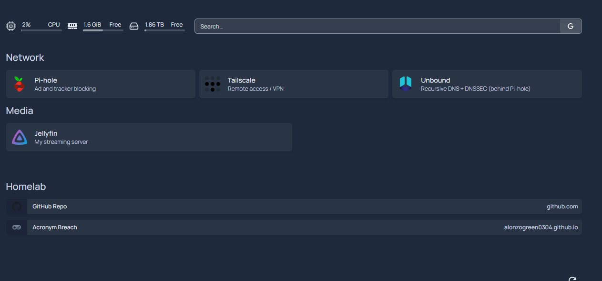

# Homepage: My Homelab Dashboard

**Beginner level:** still learning, documenting as I go.
**Set up:** October 23, 2026, on the Dell Wyse 5060 in Docker
**Project:** [gethomepage/homepage](https://github.com/gethomepage/homepage)

## What it is (simple version)

One start page for my whole homelab: a tile for every service (Pi-hole, Tailscale, Unbound, Jellyfin), live CPU / RAM / disk stats, a search bar, and bookmarks. Instead of remembering IPs and ports, I open one page.

## My setup

| Setting | Value | Why |
|---|---|---|
| Runs in | Docker (`ghcr.io/gethomepage/homepage`), host networking | Same pattern as my other services |
| Recipe | `/opt/homepage/docker-compose.yml` | |
| Config | `/mnt/agents/homepage/config/*.yaml` (external drive) | Survives container rebuilds |
| Runs as | My user (`PUID/PGID 1000`), **not root** | Least privilege |
| `HOMEPAGE_ALLOWED_HOSTS` | Only my Tailscale IP, local IP, and localhost | The page refuses to load under any other hostname |
| Drive mount | `/mnt/agents` mounted **read-only** (`:ro`) | Homepage can *read* free space but can't change anything on the drive |
| Web UI | `http://<wyse-tailscale-ip>:3000` | Reachable only on my tailnet / home network |

## Config files

| File | What it controls |
|---|---|
| `settings.yaml` | Title, dark theme, layout (Network row of 3, Media row of 2) |
| `services.yaml` | The service tiles and their links |
| `widgets.yaml` | Top bar: CPU, RAM, disk free on the external drive, Google search |
| `bookmarks.yaml` | Links to this GitHub repo and the Acronym Breach game |

## Security choices

- **No Docker socket mounted.** Homepage *can* show container status if you give it `/var/run/docker.sock`, but that socket is effectively **root access to the whole host**. Skipped for now
- **API keys stay out of YAML and out of GitHub.** Phase 2 widgets use environment variables from a locked-down `.env` file (see below)

## Next steps

- [ ] Phase 2: live widgets (Pi-hole stats, Jellyfin now-playing) using API keys from a `chmod 600` `.env` file
- [ ] Add new services here as I add them (OptiPlex, VM lab, etc.)
- [ ] Optional: small rack screen showing the dashboard
