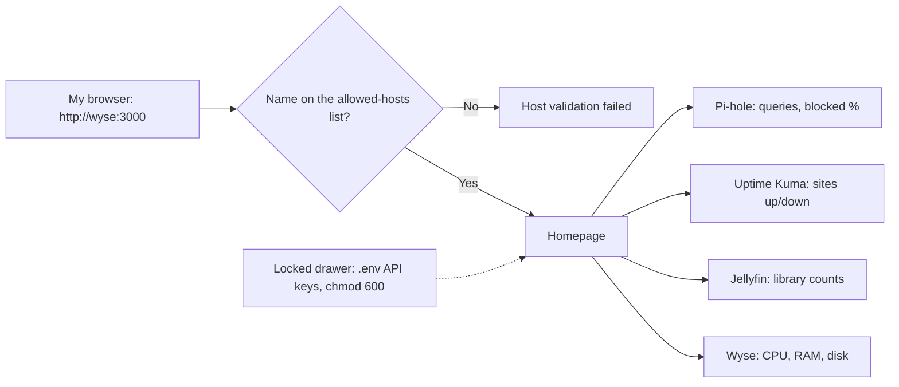
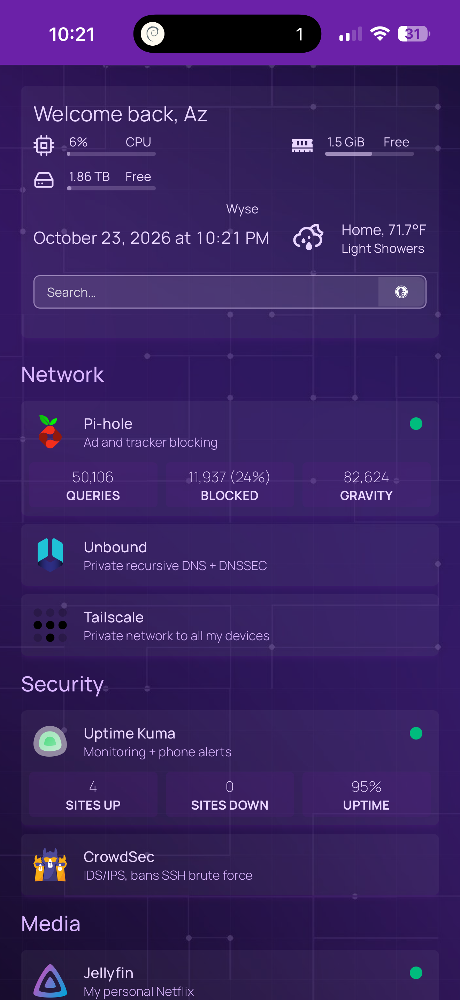

# Homepage: My Homelab Dashboard

**Beginner level:** still learning, documenting as I go.
**Set up:** October 23, 2026, on the Dell Wyse 5060 in Docker
**Project:** [gethomepage/homepage](https://github.com/gethomepage/homepage)

## What it is (simple version)

**Analogy:** The lobby directory board: one screen listing every room in the house, with live status lights and stats.

One start page for my whole homelab: a tile for every service (Pi-hole, Tailscale, Unbound, Jellyfin), live CPU / RAM / disk stats, a search bar, and bookmarks. Instead of remembering IPs and ports, I open one page.


## Visual: How the dashboard gets its numbers

**Analogy:** The lobby directory board: each tile asks its room for live numbers, using keys kept in a locked drawer (.env).



## My setup

| Setting | Value | Why |
|---|---|---|
| Runs in | Docker (`ghcr.io/gethomepage/homepage`), host networking | Same pattern as my other services |
| Recipe | `/opt/homepage/docker-compose.yml` | |
| Config | `/mnt/agents/homepage/config/*.yaml` (external drive) | Survives container rebuilds |
| Runs as | My user (`PUID/PGID 1000`), **not root** | Least privilege |
| `HOMEPAGE_ALLOWED_HOSTS` | Only my Tailscale IP, local IP, and localhost | The page refuses to load under any other hostname |
| Drive mount | `/mnt/agents` mounted **read-only** (`:ro`) | Homepage can *read* free space but can't change anything on the drive |
| Web UI | `http://<wyse-tailscale-ip>:3000` | Reachable only on my tailnet / home network |

## Config files

| File | What it controls |
|---|---|
| `settings.yaml` | Title, dark theme, layout (Network row of 3, Media row of 2) |
| `services.yaml` | The service tiles and their links |
| `widgets.yaml` | Top bar: CPU, RAM, disk free on the external drive, Google search |
| `bookmarks.yaml` | Links to this GitHub repo and the Acronym Breach game |

## Security choices

**Analogy:** The directory shows which rooms exist, but the room keys (API keys) stay in a locked drawer (`.env`, chmod 600). The board only references the drawer, so the keys never get printed on it.

- **No Docker socket mounted.** Homepage *can* show container status if you give it `/var/run/docker.sock`, but that socket is effectively **root access to the whole host**. Skipped for now
- **API keys stay out of YAML and out of GitHub.** Phase 2 widgets use environment variables from a locked-down `.env` file (see below)

## Phase 2: live widgets

**Analogy:** Upgrading the directory from a printed sign to a live scoreboard that pulls real numbers from each room.

The Pi-hole tile now shows **queries / blocked / % / gravity**, and Jellyfin shows library counts and now-playing.

**How the secrets are handled:**
- API keys live in `/opt/homepage/.env`, locked with `chmod 600` (root-only), and loaded with `env_file: .env`
- The YAML only references them: `key: "{{HOMEPAGE_VAR_PIHOLE_KEY}}"`. Keys never appear in config or on GitHub
- Pi-hole uses an **app password** (separate and revocable), not my real login
- Typed the key commands with a **leading space** so bash doesn't save them in history
- **Rotated both keys** after they showed up in a screenshot, then deleted the screenshot

**Troubleshooting the Jellyfin widget:**

| Symptom | Check | Cause | Fix |
|---|---|---|---|
| `Unexpected end of JSON input` | Homepage docs | Jellyfin **12.x** needs the newer widget API | Added `version: 2` |
| Still erroring | `curl -w "%{http_code}"` with the key → **401**, and `docker logs homepage` showed 401s | Jellyfin rejecting the key | |
| | `awk` to print the key's **length** (not the key) → **6** instead of 32 | The placeholder text got saved instead of the real key | Pasted the real key → length 32 → widget works |

**Lesson:** check secrets *without displaying them*. Measuring a key's length found the problem without ever printing the key.

## Phase 3: redesign (Oct 23, 2026)

**Analogy:** Repainting the lobby (purple theme, background) and adding new sections for security and studying.



What changed:
- **Look:** renamed to *Alonzo's Lab*, purple accent (`color: purple`), frosted-glass cards (`cardBlur: sm`), and a custom purple circuit-board background I generated and host in this repo ([`images/dashboard-bg.jpg`](images/dashboard-bg.jpg)), dimmed with `brightness: 75`
- **Top bar:** greeting, date/time, local weather (Open-Meteo, no API key), CPU / RAM / big-drive free space, DuckDuckGo search
- **Status dots** (`siteMonitor`) on Pi-hole, Uptime Kuma, and Jellyfin: green = answering right now
- **New Security row:** Uptime Kuma with a live widget (sites up / down / uptime %, from a status page with slug `lab`) and CrowdSec
- **Study row:** one-tap links to my three study games (Command Center, Know Your Lab, Acronym Breach)

**How I changed it safely:** backed up the whole config folder first (`sudo cp -r .../config .../config.bak`), then rewrote each YAML file with `sudo tee` heredocs. Homepage reloads config changes on its own. API keys stayed in `.env`; the YAML only references them.

## Phase 4: MagicDNS name + Lab House (Oct 24, 2026)

**Problem:** opening the dashboard by its new Tailscale name (`http://wyse:3000`) returned `{"error":"Host validation failed."}`.

**Why:** `HOMEPAGE_ALLOWED_HOSTS` is Homepage's guest list of names it will answer to. It only had the IP-based ones. This protects against **DNS rebinding**, an attack where a malicious website tricks your browser into reaching your home server under a fake name. So the error was the security feature doing its job.

**Analogy:** the doorman only lets in names on the guest list. I added my nickname to the list. The doorman reads the list at the start of each shift, so the container had to be re-created (`up -d`), not just restarted.

```bash
sudo cp /opt/homepage/docker-compose.yml /opt/homepage/docker-compose.yml.bak
sudo sed -i 's|localhost:3000"|localhost:3000,wyse:3000,wyse.<tailnet>.ts.net:3000"|' /opt/homepage/docker-compose.yml
grep -n ALLOWED /opt/homepage/docker-compose.yml
cd /opt/homepage && sudo docker compose up -d
```

**Also:** added [Lab House](https://alonzogreen0304.github.io/Homelab/games/lab-house.html) as the first tile in the Study row (now a 2x2 grid with Command Center, Know Your Lab, Acronym Breach), and switched the Uptime Kuma bookmark to `http://wyse:3001`.

## Next steps

- [x] Phase 2: live widgets (Pi-hole stats, Jellyfin) with keys in a `chmod 600` `.env` file
- [x] Phase 3: purple redesign, weather, status dots, Security + Study rows
- [ ] CrowdSec widget (live alerts / bans)
- [ ] Docker container status through a read-only socket proxy (least privilege)
- [ ] Add new services here as I add them (OptiPlex, VM lab, etc.)
- [ ] Optional: small rack screen showing the dashboard
