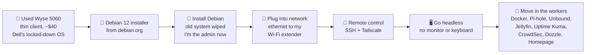
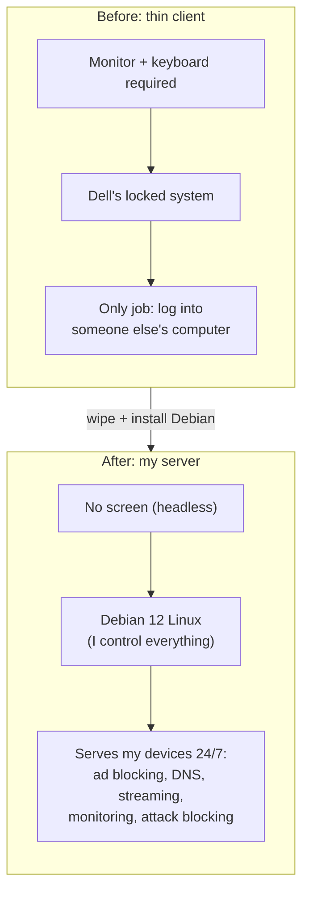
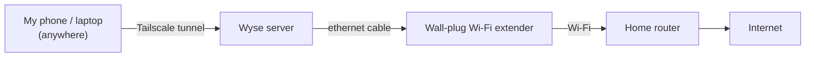

# How My Server Got Here

**From a $40 used office computer to an always-on home server.**

## What it is (simple version)

The Dell Wyse 5060 was never built to be a server. It's a **thin client**: a small office computer made to be a "dumb screen" that logs into a bigger computer somewhere else. Companies replace them in bulk, so they sell used for cheap. "Server" describes a **job**, not a special machine, so I gave it that job.

> **Analogy:** I bought an old empty storefront and turned it into a restaurant. The building came empty (the hardware). Installing Debian was gutting it and hiring a manager (the OS). Plugging into the network got it a street address. SSH and Tailscale are the back door and a phone line, so I can run it without standing inside. Then the cooks moved in (the programs).

---

## Visual: the journey

## Visual: before vs after

## Visual: how it's connected today

> **Analogy:** the extender is a **bridge**. The Wyse speaks "cable," the router speaks "Wi-Fi," and the extender translates between them.

---

## The steps

| # | Step | Why it matters |
|---|---|---|
| 1 | Bought a used Wyse 5060 | Cheap, quiet, low power, so it can run 24/7 |
| 2 | Downloaded Debian 12 from the official site | Trusted source (supply-chain safety) |
| 3 | Booted the installer and installed Debian | Replaced Dell's OS; I'm root/admin now |
| 4 | Connected it by ethernet through my Wi-Fi extender | Other devices can reach it |
| 5 | Set up SSH (key-only) and Tailscale | Control it from my laptop or phone, from anywhere |
| 6 | Unplugged the monitor and keyboard | Runs **headless**, like real data-center servers |
| 7 | Installed Docker and the services | It finally has a job to *serve* |

## Security angle

- **Clean, trusted build:** wiping the old system and installing from the official source means I know what's on the machine. It's the same idea as companies **re-imaging** used laptops before giving them out.
- **Headless + remote:** fewer physical attack points. Access goes through SSH keys and Tailscale, not someone sitting at a keyboard.

## Related notes

- [Wyse boot failure recovery](wyse-boot-recovery.md)
- [First headless boot + remote access](remote-access-log.md)
- [SSH setup](ssh-setup.md) · [Tailscale](tailscale.md)
- Interactive version: [Lab House → "How did my server get there?"](https://alonzogreen0304.github.io/Homelab/games/lab-house.html)
