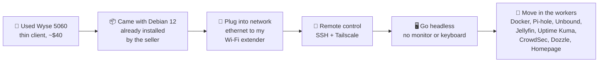
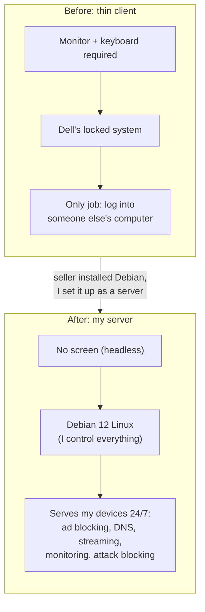
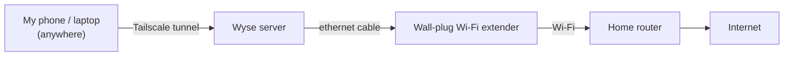

# How My Server Got Here

**From a $40 used office computer to an always-on home server.**

## What it is (simple version)

The Dell Wyse 5060 was never built to be a server. It's a **thin client**: a small office computer made to be a "dumb screen" that logs into a bigger computer somewhere else. Companies replace them in bulk, so they sell used for cheap. "Server" describes a **job**, not a special machine, so I gave it that job.

> **Analogy:** I bought an old storefront and turned it into a restaurant. The seller had already gutted it and hired a manager (Debian came pre-installed). Plugging into the network got it a street address. SSH and Tailscale are the back door and a phone line, so I can run it without standing inside. Then the cooks moved in (the programs).

---

## Visual: the journey

## Visual: before vs after

## Visual: how it's connected today

> **Analogy:** the extender is a **bridge**. The Wyse speaks "cable," the router speaks "Wi-Fi," and the extender translates between them.

---

## The steps

| # | Step | Why it matters |
|---|---|---|
| 1 | Bought a used Wyse 5060 | Cheap, quiet, low power, so it can run 24/7 |
| 2 | It arrived with Debian 12 already installed by the seller | Saved setup time, but I didn't build it myself (see Security angle) |
| 3 | Logged in and took over as admin | It's my machine now |
| 4 | Connected it by ethernet through my Wi-Fi extender | Other devices can reach it |
| 5 | Set up SSH (key-only) and Tailscale | Control it from my laptop or phone, from anywhere |
| 6 | Unplugged the monitor and keyboard | Runs **headless**, like real data-center servers |
| 7 | Installed Docker and the services | It finally has a job to *serve* |

## Security angle

- **Trust gap (supply-chain risk):** the seller installed Debian, not me. I can't fully prove what else they set up, such as extra users, SSH keys, or startup scripts. Companies **re-image** used machines for this reason.
- **Two ways to close the gap:**
  1. **Best:** reinstall Debian from the official debian.org image (a clean, trusted build). This means re-setting up the services.
  2. **Good:** audit what's there now: users (`getent passwd`), admins (`getent group sudo`), SSH keys (`~/.ssh/authorized_keys`), scheduled jobs (`crontab -l`, `/etc/cron*`), and running services (`systemctl list-units --type=service --state=running`).
- **Headless + remote:** fewer physical attack points. Access goes through SSH keys and Tailscale, not someone sitting at a keyboard.

> **Analogy:** buying a used house. The seller hands you keys, but you don't know who else has copies. Re-imaging is changing every lock, and the audit is walking through checking every door.

## Related notes

- [Wyse boot failure recovery](wyse-boot-recovery.md)
- [First headless boot + remote access](remote-access-log.md)
- [SSH setup](ssh-setup.md) · [Tailscale](tailscale.md)
- Interactive version: [Lab House → "How did my server get there?"](https://alonzogreen0304.github.io/Homelab/games/lab-house.html)
