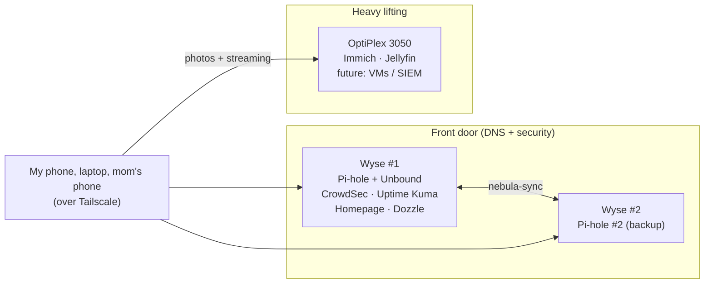
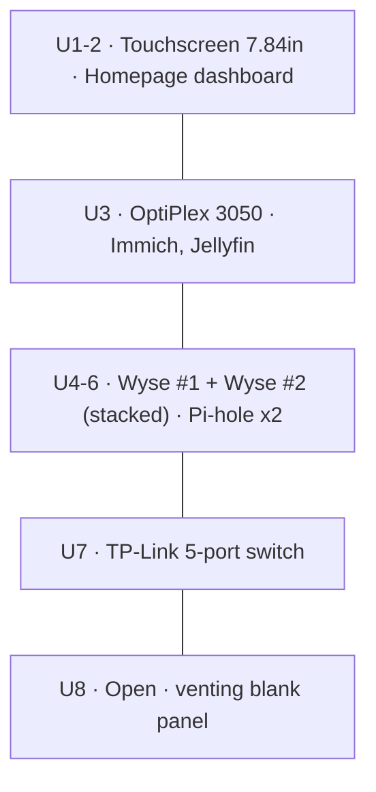
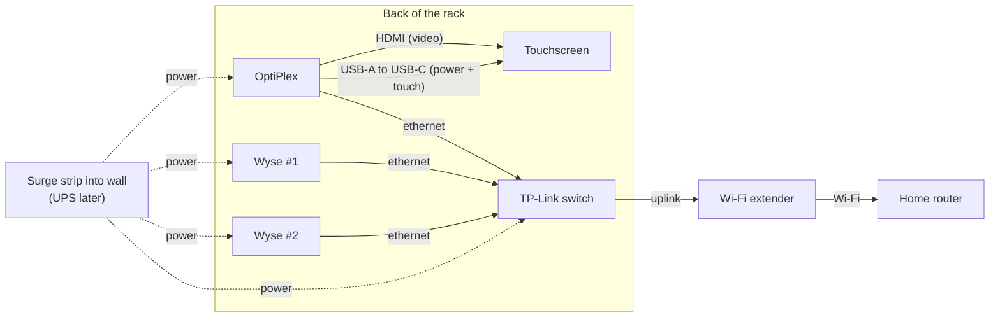
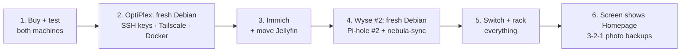

# Lab Expansion Plan: 3 Machines + a Mini Rack

**Planned:** Oct 26, 2026
**Why:** I want Immich (self-hosted photo backup), and my current Wyse 5060 can't run it. It has **3.3GB RAM with only about 1.3GB free**, and Immich needs **6GB minimum** (4GB with machine learning off). Instead of cramming more onto one box, I'm splitting the lab into roles and racking it.

> **Analogy:** my Wyse is a studio apartment that's already full of roommates. Instead of squeezing in one more, I'm moving to a small building: two security guards at the front door (the Wyses) and one strong worker in the back moving the heavy boxes (the OptiPlex).

---

## The machines

| Machine | Specs | Cost | Job |
|---|---|---|---|
| **Wyse #1 (current)** | AMD GX-424CC, 4 cores, 3.3GB RAM | already own | Pi-hole + Unbound, CrowdSec, Uptime Kuma, Homepage, Dozzle |
| **Wyse #2 (new)** | Same as #1. Sold with "no AC" (no power adapter), drive unconfirmed | $15 | **Pi-hole #2**: backup DNS, synced with nebula-sync |
| **Dell OptiPlex 3050 Micro** | Intel i5-7500T, 8GB RAM (2 slots), 128GB SSD, HDMI | $80 | **Immich** (photo backup), **Jellyfin** (moved over), room for VMs / a SIEM later |

**Why not a Wyse 5070?** The 5070 listing ($40) was "base device with CPU only": no RAM, no storage, no power adapter, and its Celeron J4105 is much weaker. Once you add parts, it costs about the same as the OptiPlex, which is complete and roughly 2-3× faster.

---

## The rack: front view (DeskPi RackMate T1 Plus, 10", 8U, 10.23" deep)

Picked the **T1 Plus** over the regular T1 (sold out) because it's **10.23" deep instead of 7.87"**. The OptiPlex is about 7" deep before cables.

| Row (U) | Item | Sits on |
|---|---|---|
| 1–2 | 7.84" touchscreen, shows the Homepage dashboard | Mounts directly |
| 3 | OptiPlex 3050 | 2-pack shelf #1 |
| 4–6 | Wyse #1 + Wyse #2, lying flat, stacked | Shelf included with the rack |
| 7 | TP-Link TL-SG105 switch | 2-pack shelf #2 |
| 8 | Open: airflow + future gear | Venting blank panel (included) |

> **Analogy:** a bookshelf. The TV goes on top, the workers in the middle, the internet hookup at the bottom, and one empty slot so it can breathe. The Wyses have no fans, so they need that air.

---

## The rack: rear view and cabling

**Switch port map (TL-SG105):**
| Port | Plugs into |
|---|---|
| 1 | Uplink to Wi-Fi extender |
| 2 | Wyse #1 |
| 3 | Wyse #2 |
| 4 | OptiPlex |
| 5 | Spare |

**Cabling rules:**
1. Power runs down one side, data down the other.
2. Label both ends of every cable ("Wyse 2").
3. Use short cables (1 ft Cat6) and velcro ties, not zip ties.
4. The screen plugs into the **OptiPlex**, because it has HDMI. The Wyse 5060 only has DisplayPort.

> **Analogy:** the switch is a power strip for internet. One cable comes in from the extender and gets shared with every server.

---

## Power

- **Now:** a power strip into the wall. It needs to be a **surge protector** (look for a joule rating on the label), not just an extension block. Never plug a strip into another strip.
- **Total draw is under 100W:** Wyse about 7-10W each, OptiPlex about 10-35W, switch about 3W, screen powered from the OptiPlex's USB.
- **Later, a UPS** (about $100-110 new): APC Back-UPS BE600M1 (330W, **5 battery outlets**, which is exactly what I need), or a CyberPower EC650LCD (390W, USB shutdown confirmed on Linux). Get one with a **USB data port** so the servers can shut themselves down cleanly (`apcupsd` / NUT). Budget hack: buy a used UPS and put a new battery in it (about $20-30).
- **Until then:** set **BIOS → AC Recovery → Power On** on each machine so they turn back on after an outage. Uptime Kuma alerts me if anything doesn't.

> **Analogy:** a plain extension block is a longer hose. A surge protector is a hose with a pressure valve. A UPS is a backup water tank.

---

## Shopping list

| Item | Where | Price | Status |
|---|---|---|---|
| Dell OptiPlex 3050 Micro | Facebook Marketplace | $80 | Confirm the power adapter is included, see it boot |
| Dell Wyse 5060 | Facebook Marketplace | $15 | Needs a power adapter (match Wyse #1's label). Check the drive in the BIOS (F2) |
| GeeekPi DeskPi RackMate T1 Plus 8U | [Amazon](https://www.amazon.com/GeeekPi-Cabinet-RackMate-Equipment-10-23inch/dp/B0FWJXF7FM) | $139.99 | In cart |
| GeeekPi 7.84" touchscreen 2U | [Amazon](https://www.amazon.com/GeeekPi-1280x400-Monitor-RackMate-Cabinet/dp/B0F3C5R2BZ) | $99.99 | In cart |
| TP-Link TL-SG105 switch | [Amazon](https://www.amazon.com/dp/B00A128S24) | $12.99 | In cart |
| GeeekPi 1U shelves 2-pack, 10.23" deep | [Amazon](https://www.amazon.com/GeeekPi-Server-Cantilever-Rackmate-Network/dp/B0H876TBW9) | check listing | Add |
| Short Cat6 cables + velcro ties | Amazon | ~$10-15 | Add |
| Surge protector strip | any | ~$15-25 | If my current strip isn't one |
| Crucial 8GB DDR4-2400 SO-DIMM | Amazon | $66 in cart (high) | **Wait.** Check the OptiPlex for a free slot first, then compare sellers |
| UPS (APC BE600M1 or similar) | later | ~$100-110 | Later |

**What the rack includes:** 1× 1U shelf, 1U venting blank panel, 2 blank panels, screws, handles, rubber feet.

---

## Setup order

1. **Buy and test.** See both machines power on before paying.
2. **OptiPlex:** write Debian 12 to a USB stick (Rufus), boot it with **F12**, and install with **"use entire disk."** Then set up SSH keys, Tailscale, and Docker.
3. **Immich** on the OptiPlex, then **move Jellyfin** off Wyse #1 to free its RAM.
4. **Wyse #2:** fresh Debian, then Pi-hole #2, synced with nebula-sync.
5. **Network + rack:** connect everything to the switch, then mount it all.
6. **Finish:** the touchscreen shows Homepage, and photos get a **3-2-1 backup** (3 copies, 2 types of storage, 1 offsite) with restic or Kopia. Immich alone is not a backup.

---

## GRC angle (portfolio material)

- **Clean builds:** wipe both machines and install Debian myself from debian.org. That fixes the supply-chain question my first Wyse still has (it came with Debian pre-installed by the seller).
- **Media sanitization (NIST SP 800-88):** the seller said the Wyse 5060s "come from gov libraries," so the drives may still hold old data. **Don't browse it, wipe it.** Installing with "use entire disk" overwrites it.
- **Asset inventory (side quest 1):** 3 machines, their roles, IPs, and owners. Also: every device on the tailnet should be one I recognize.
- **Availability / redundancy:** two Pi-holes means no single point of failure for DNS.
- **BC/DR (side quest 6):** RTO/RPO for photos, the 3-2-1 backup, and the UPS + AC Recovery plan.

> **Analogy:** buying used government equipment is like buying a used library filing cabinet. There might still be papers in the drawers. The right move is to shred them, not read them.
