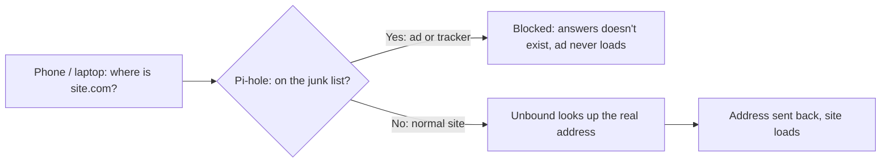

# Pi-hole

**Beginner level:** still learning, documenting as I go.

## What it is (simple version)

**Analogy:** Pi-hole is the house's mail sorter. Before any device fetches a website, it asks for the address. Pi-hole checks a junk list and refuses to give out addresses for ads and trackers, so they never arrive.

Every time a device visits a website or loads an ad, it first asks a **DNS server** "what's the address for this name?" Think of DNS as the internet's phone book.

**Pi-hole is my own phone book.** When a device asks for a known ad or tracking domain, Pi-hole just doesn't answer, so the ad never loads. Normal sites work like usual.

Because it works at the network level, it can block ads on devices where you can't install an ad blocker, like smart TVs and game consoles.

## Visual: How Pi-hole works

**Analogy:** The mail sorter: every lookup passes through it, junk gets thrown out, real mail goes on to the address book (Unbound).



## My setup

- **Runs on:** Dell Wyse 5060 (Debian 12)
- **Installed with:** Docker (`pihole/pihole` image)
- **Network mode:** host (uses the server's network directly)
- **Upstream DNS:** [Unbound](unbound.md) on `127.0.0.1#5335` (no Google/Cloudflare/ISP)
- **Blocklist size:** ~82,000 domains
- **Dashboard:** `http://<server-ip>/admin`

## Useful commands

```bash
sudo docker ps                                   # is Pi-hole running? look for "Up" and "(healthy)"
sudo docker restart pihole                       # restart it
sudo docker exec -it pihole pihole setpassword   # reset the dashboard password
sudo ss -tulpn | grep :53                        # confirm something is answering DNS (port 53)
```

## Current status

- ✅ Running and healthy, starts automatically on boot
- ✅ My laptop and phones use it from anywhere over Tailscale ([log](pihole-docker-recovery-log.md))
- 🔜 Next: set my router's DNS to Pi-hole so every device on Wi-Fi is covered

## What Pi-hole blocks (and what it can't)

**Analogy:** A mail sorter can throw out mail from known junk senders, but it can't open an envelope from a trusted sender and remove the ad inside. That's why YouTube ads (same address as the videos) get through.

**Simple version:** every device looks up a website's address in a "phone book" (DNS) before connecting. Pi-hole is my own phone book, at my house, with ~82,000 ad and tracker companies crossed out. Tailscale is a private tunnel that lets my phone and laptop use that phone book from anywhere.

Because it works at the phone book level, it covers **every app on the device**, not just the browser:

| Where | What gets blocked | Seen in my own logs |
|---|---|---|
| Browsers (Safari, Chrome) | Banner ads, "sponsored stories," trackers | `cdn.taboola.com`, `googletagservices.com` |
| Apps | In-app ads in free games, weather, news apps | |
| App analytics | Apps reporting what I tap and how long I stay | `firebaselogging-pa.googleapis.com` |
| Streaming analytics | Video apps reporting viewing behavior | `conviva.com` |
| Telemetry | Devices "phoning home" with usage data | |

Blocking trackers and analytics is arguably the bigger win than ads. It's **privacy**: less of my data going to ad companies.

**What it can't block:**
- **YouTube ads.** Served from the same servers as the videos
- **Instagram / TikTok / Facebook sponsored posts.** Part of the feed itself
- **Spotify / Hulu ads**, mostly. Same reason

**Rule of thumb:** if the ad comes from a **separate ad company's domain**, Pi-hole kills it. If it comes from the **same domain as the content**, Pi-hole can't tell them apart.

**If something breaks** (a shopping link, a sponsored search result, an app feature): check the Query Log for a red `blocked` line at that time and **allowlist** the domain.

**Interview version:** "I run Pi-hole as a DNS sinkhole on my homelab server and route my devices' DNS to it over a Tailscale WireGuard tunnel, so I get network-level ad and tracker blocking from anywhere without exposing the server to the internet."

## Reading the dashboard (snapshot: Oct 22, 2026, ~12:20 AM)

**Analogy:** The sorter's daily report: how much mail came in, how much was junk, and which junk senders showed up most.


The dashboard only shows the **last 24 hours**, so numbers drop as old activity "rolls off."

| Box | Value | What it means in plain English |
|---|---|---|
| **Total Queries** | 588 | 588 times a device asked Pi-hole "where is this website?" in the last 24 hours |
| **Active clients** | 2 | Two devices used Pi-hole: the Wyse itself, and my phone (earlier, while Tailscale was sending my phone's DNS here) |
| **Queries Blocked** | 92 | 92 of those lookups were ads or trackers, and Pi-hole refused to answer them |
| **Percentage Blocked** | 15.6% | 92 ÷ 588. About 1 in 6 lookups was an ad or tracker |
| **Domains on Lists** | 82,624 | The size of my blocklist: known ad/tracker domains Pi-hole will refuse |

**The graph:** almost all activity is one spike around **3 PM**. That was my phone, while Tailscale DNS was pointing at Pi-hole. After I turned that off (see the [remote access log](remote-access-log.md)), my phone stopped using Pi-hole, so the graph goes flat. The Wyse on its own barely makes any lookups.

**Why the percentage jumped from 2.7% to 15.6%:** Pi-hole didn't block more. The **total** got smaller, because the 1,800-lookup spike from installing updates the night before rolled out of the 24-hour window. Same 92 blocks divided by fewer total lookups gives a bigger percentage. Lesson: **always check what a percentage is a percentage *of*.**

**The orange "1" badge:** that's the old *"Disk shortage ahead"* warning from when the drive was 93% full. I've since cleaned it up to 81% ([log](disk-cleanup-and-ssh-log.md)), so it can be cleared.

**Takeaway:** the blocking works. On the one device that used it, about 1 in 6 lookups was an ad or tracker. Once the whole house (router DNS) or my phone on the go (Tailscale DNS → the Wyse's Tailscale IP) uses Pi-hole, these numbers will climb.

## What I learned

- DNS runs on **port 53**
- If Pi-hole is your only DNS server and it goes down, the whole house loses internet, so the server needs to be reliable
- Don't add a backup DNS like `8.8.8.8` on the router, or devices will skip Pi-hole
- It **can't** block YouTube ads, because those come from the same servers as the videos
