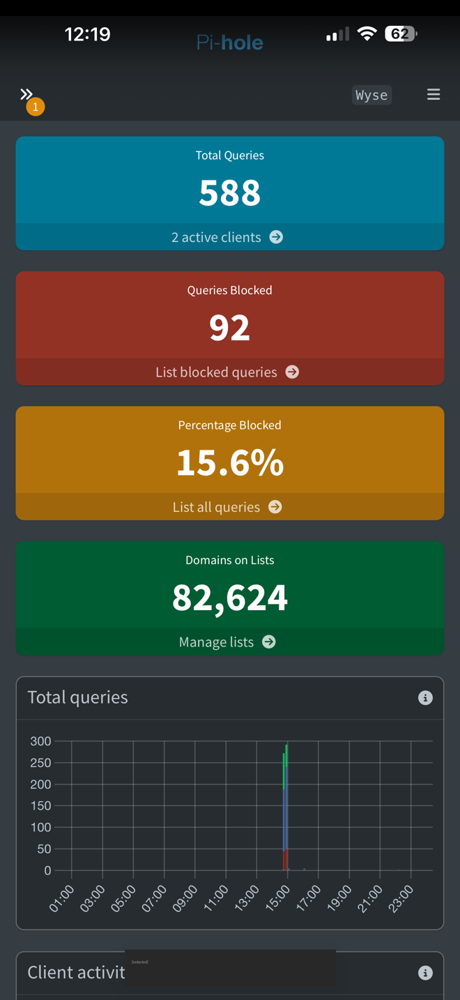

# Pi-hole

**Beginner level:** still learning, documenting as I go.

## What it is (simple version)

Every time a device visits a website or loads an ad, it first asks a **DNS server** "what's the address for this name?" Think of DNS as the internet's phone book.

**Pi-hole is my own phone book.** When a device asks for a known ad or tracking domain, Pi-hole just doesn't answer, so the ad never loads. Normal sites work like usual.

Because it works at the network level, it can block ads on devices where you can't install an ad blocker, like smart TVs and game consoles.

## My setup

- **Runs on:** Dell Wyse 5060 (Debian 12)
- **Installed with:** Docker (`pihole/pihole` image)
- **Network mode:** host (uses the server's network directly)
- **Blocklist size:** ~82,000 domains
- **Dashboard:** `http://<server-ip>/admin`

## Useful commands

```bash
sudo docker ps                                   # is Pi-hole running? look for "Up" and "(healthy)"
sudo docker restart pihole                       # restart it
sudo docker exec -it pihole pihole setpassword   # reset the dashboard password
sudo ss -tulpn | grep :53                        # confirm something is answering DNS (port 53)
```

## Current status

- ✅ Running and healthy, starts automatically on boot
- ⚠️ Only the server itself is using it right now (my phone used it briefly; see dashboard snapshot above)
- 🔜 Next: set my router's DNS to Pi-hole so every device on Wi-Fi is covered

## Reading the dashboard (snapshot: Oct 22, 2026, ~12:20 AM)



The dashboard only shows the **last 24 hours**, so numbers drop as old activity "rolls off."

| Box | Value | What it means in plain English |
|---|---|---|
| **Total Queries** | 588 | 588 times a device asked Pi-hole "where is this website?" in the last 24 hours |
| **Active clients** | 2 | Two devices used Pi-hole: the Wyse itself, and my phone (earlier, while Tailscale was sending my phone's DNS here) |
| **Queries Blocked** | 92 | 92 of those lookups were ads or trackers, and Pi-hole refused to answer them |
| **Percentage Blocked** | 15.6% | 92 ÷ 588. About 1 in 6 lookups was an ad or tracker |
| **Domains on Lists** | 82,624 | The size of my blocklist: known ad/tracker domains Pi-hole will refuse |

**The graph:** almost all activity is one spike around **3 PM**. That was my phone, while Tailscale DNS was pointing at Pi-hole. After I turned that off (see the [remote access log](remote-access-log.md)), my phone stopped using Pi-hole, so the graph goes flat. The Wyse on its own barely makes any lookups.

**Why the percentage jumped from 2.7% to 15.6%:** Pi-hole didn't block more. The **total** got smaller, because the 1,800-lookup spike from installing updates the night before rolled out of the 24-hour window. Same 92 blocks divided by fewer total lookups gives a bigger percentage. Lesson: **always check what a percentage is a percentage *of*.**

**The orange "1" badge:** that's the old *"Disk shortage ahead"* warning from when the drive was 93% full. I've since cleaned it up to 81% ([log](disk-cleanup-and-ssh-log.md)), so it can be cleared.

**Takeaway:** the blocking works. On the one device that used it, about 1 in 6 lookups was an ad or tracker. Once the whole house (router DNS) or my phone on the go (Tailscale DNS → the Wyse's Tailscale IP) uses Pi-hole, these numbers will climb.

## What I learned

- DNS runs on **port 53**
- If Pi-hole is your only DNS server and it goes down, the whole house loses internet, so the server needs to be reliable
- Don't add a backup DNS like `8.8.8.8` on the router, or devices will skip Pi-hole
- It **can't** block YouTube ads, because those come from the same servers as the videos
