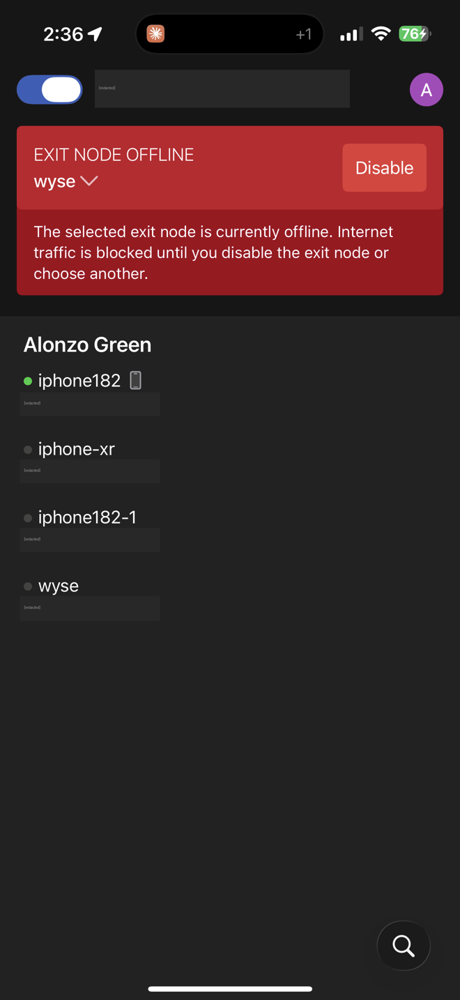
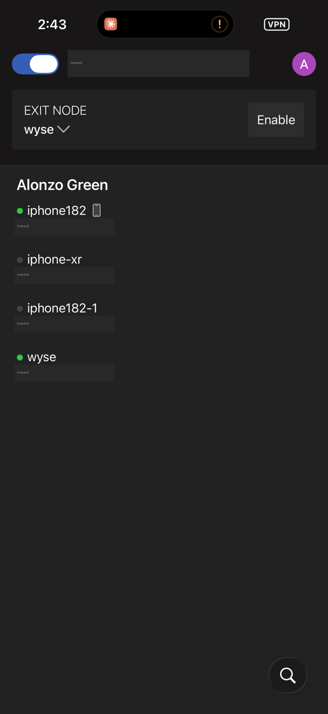
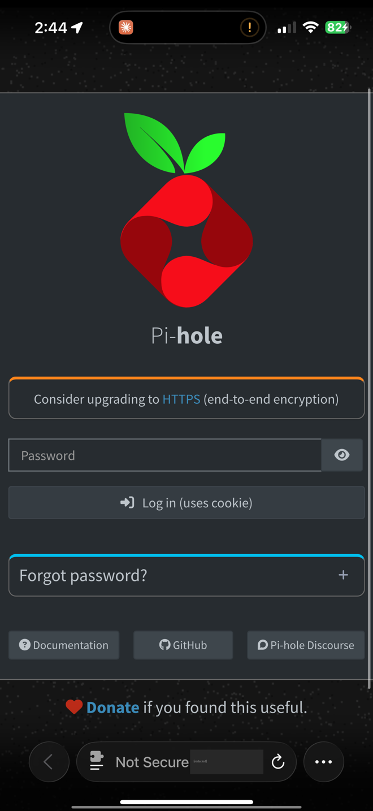

# Homelab Log: First Headless Boot + Remote Access with Tailscale

**Date:** October 21, 2026
**Device:** Dell Wyse 5060 (Debian 12), iPhone with the Tailscale app
**Outcome:** The Wyse now boots with no monitor and no login, and I can reach Pi-hole from my phone through Tailscale, from anywhere

**Beginner level:** still learning, documenting as I go. Screenshots have my email and IPs redacted.

---

## Summary

I turned on the Wyse with no monitor attached for the first time and tried to reach it from my phone. Two things went wrong, and both taught me something:

1. My phone lost all internet because Tailscale was set to send everything through the Wyse (exit node), and the Wyse was offline.
2. The Wyse stayed offline because its ethernet cable wasn't plugged in, and Debian only checks for the network at boot.

After fixing both, the Wyse came online by itself, with no login, and I opened the Pi-hole dashboard on my phone through the encrypted Tailscale tunnel.

---

## Step 1: My phone's internet got blocked

**What happened:** the Tailscale app showed **"EXIT NODE OFFLINE"** and my phone couldn't load anything.

**Why:** at some point I had set the Wyse as my phone's **exit node**. That means *all* of my phone's internet traffic goes through the Wyse first, like a personal VPN. With the Wyse offline, Tailscale blocked my traffic instead of letting it leak out unprotected. That's a security feature called a **kill switch**.

**Fix:** tapped **Disable** on the red banner. Internet came right back.

**Extra lesson:** the exit node wouldn't have worked even with the Wyse online, because **IP forwarding** is still disabled on the Wyse (see [tailscale.md](tailscale.md)). Until that's fixed, the exit node stays off.

---

## Step 2: Figured out why the Wyse was offline

The `wyse` machine had a **gray dot** (offline) in the Tailscale app.

**Checklist I ran through:**
- Power light on? Yes
- Booted long enough (2–3 minutes)? Yes
- **Ethernet cable plugged in? No.** Found the problem.

**Why that mattered:** the Wyse has no Wi-Fi, so with no cable it has no network at all. Also, my network config (`/etc/network/interfaces`) uses `auto enp4s0`, which only brings the ethernet port up **at boot**. Plugging the cable in afterwards isn't enough. The machine has to be restarted with the cable already in.

**Fix:**
1. Plugged in the ethernet cable
2. Tapped the power button once to shut down cleanly (not held down)
3. Powered it back on and waited about 2 minutes

---

## Step 3: The Wyse came online by itself

The `wyse` machine turned **green**: no monitor, no keyboard, nobody logged in.

That proved everything starts automatically at boot:
- **Network:** ethernet came up and got an IP from the router (DHCP)
- **Tailscale:** reconnected to my tailnet on its own
- **Docker + Pi-hole:** started on their own

Running without a monitor like this is called running **headless**, which is how real servers run.

Note the exit node now shows **Enable** instead of the red banner. It's off, which is what I want for now.

---

## Step 4: Opened Pi-hole from my phone through Tailscale

Opened `http://<wyse-tailscale-ip>/admin` in Safari and the Pi-hole login page loaded.

**How to reach the Wyse from my phone:**

| Address | Works from | Notes |
|---|---|---|
| `http://<wyse-tailscale-ip>/admin` (starts with `100.`) | **Anywhere**: cellular, work, school Wi-Fi | Needs the Tailscale toggle on |
| `http://<wyse-local-ip>/admin` (starts with `192.168.`) | **Home Wi-Fi only** | Local network address |

**About "Not Secure":** Safari says that because Pi-hole uses plain HTTP. Over Tailscale it's still safe, since the whole connection is encrypted inside the Tailscale tunnel (WireGuard). Over the `192.168` address on someone else's Wi-Fi it would NOT be encrypted, so I only use the Tailscale address when I'm away.

---

## Step 5: Tailscale broke my internet on my main router

**What happened:** my home has two networks: the main router, and a Wi-Fi extender (the Wyse is plugged into the extender by ethernet). On the extender's network everything worked. On the main router, my phone said **"No Internet Connection"** whenever Tailscale was on.

**How I narrowed it down (one change at a time):**

| Test | Result | What it ruled out |
|---|---|---|
| Exit node off | Still broken | Not the exit node |
| Turned off "Use Tailscale Subnets" | Still broken | Not subnet routing |
| Turned Tailscale off completely | **Worked** | It's something Tailscale changes |
| Tailscale on, **"Use Tailscale DNS" off** | **Worked** | **It's DNS** |

**Root cause (confirmed in the Tailscale admin console → DNS):**
- **Override DNS servers** was **on**, forcing every Tailscale device to use one nameserver
- That nameserver was the Wyse's **local** IP (`192.168.x.x`), not its Tailscale IP

A local `192.168` address only works on the same network as the Wyse (the extender's network). On the main router, at work, or on cellular, my phone couldn't reach it, so **every** website lookup failed. It only looked like it worked at home because I was usually on the extender's Wi-Fi.

**Fix:**
1. Tailscale admin console → **DNS** → turned **off "Override DNS servers"** (kept MagicDNS on)
2. Phone → Tailscale app → **Settings** → turned **"Use Tailscale DNS" back on**
3. Tested websites on the main router with Tailscale on

Now devices use whatever network they're on for normal lookups, and Tailscale only handles tailnet names.

**Lesson:** a local IP (`192.168.x.x`) in a VPN-wide setting is a trap, because VPN devices aren't on your local network. Anything Tailscale-wide should point at a **Tailscale IP** (`100.x.x.x`).

---

## Requirements for remote access to work

1. Tailscale toggle **on** in the phone app
2. Wyse **powered on with ethernet plugged in before boot**
3. Home internet **up** (power or internet outage at home = can't reach it)
4. Some work/school networks block VPNs. If so, switch to cellular data

**Rule for anywhere:** if the internet ever stops working while Tailscale is on, flip the Tailscale toggle **off** first. If that fixes it, it was Tailscale. If not, it's the network.

**Seen in real life:** right after switching my phone from cellular back to home Wi-Fi, nothing would load (I couldn't even send a message). Turning Tailscale off and back on fixed it instantly. Tailscale sometimes needs a reconnect after the phone changes networks.

---

## Key takeaways

- **Exit node = all traffic goes through the Wyse.** If the Wyse is down, the phone's internet is blocked (kill switch). Keep it off until IP forwarding is fixed.
- **Servers don't need a monitor or a login.** Services start at boot on their own.
- **Plug network cables in before booting** with my current config.
- **Change one thing at a time.** Toggling settings one by one is how I proved it was DNS.
- **Troubleshoot in layers:** power → cable → network → service. The problem was the cable, not the software.
- **Redact before posting:** emails, IPs, and device addresses get blurred in every screenshot.

---

## Next steps

- [ ] Change `auto enp4s0` to `allow-hotplug enp4s0` so a cable plugged in after boot still works
- [ ] Fix IP forwarding, then approve the Wyse as an exit node in the Tailscale admin console
- [ ] Remove old iPhones from the Tailscale machine list
- [ ] Reset the Pi-hole dashboard password over SSH (`sudo docker exec -it pihole pihole setpassword`)
- [ ] Bring back Pi-hole ad blocking on the go: set the global nameserver to the Wyse's **Tailscale** IP and let Pi-hole accept queries from the tailnet
- [ ] Figure out how the main router and the extender networks relate (same network or two separate ones)
- [ ] Set up SSH from my laptop ([ssh-setup.md](ssh-setup.md))
