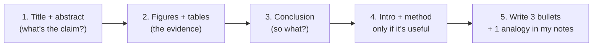

# Resources: What to Read, Mapped to My Roadmap

Two shelves:
1. **h4cker**: a giant free cybersecurity library on GitHub. Only the folders that fit my path are listed here.
2. **Research papers and reports**: the classic papers behind the ideas I'm learning (least privilege, kill chain, risk math, SOC burnout).

Each one is tagged with the [roadmap](grc-consultant-roadmap.md) level where it helps most ([visual roadmap](https://alonzogreen0304.github.io/Homelab/games/roadmap.html)).

> **Analogy:** h4cker is the **library**: huge, so you check out only the shelves you need. Research papers are the **original recipes**: frameworks like NIST and ATT&CK are dishes built on them. Reading the recipe shows you *why* the dish works, and that's what makes you sound like you get it in an interview.

---

## Visual: where everything fits

```mermaid
flowchart LR
    subgraph L0["Level 0-1: Foundations + Security+"]
        A1["h4cker: fundamentals<br/>certifications/comptia<br/>cheat-sheets"]
        A2["Paper: Saltzer & Schroeder<br/>(design principles)"]
        A3["Paper: Trusting Trust<br/>(supply chain)"]
    end
    subgraph L2["Level 2-3: GRC Analyst / SOC"]
        B1["h4cker: governance-risk-compliance<br/>defensive-security<br/>build-your-own-lab"]
        B2["NIST 800-61r3, IR 8286"]
        B3["Kill Chain · Diamond · ATT&CK"]
        B4["99% False Positives<br/>Analyst Burnout"]
    end
    subgraph L4["Level 4-5: Consultant + Own Firm"]
        C1["Gordon-Loeb<br/>(how much to spend)"]
        C2["Verizon DBIR<br/>IBM Cost of a Breach"]
        C3["h4cker: ai/ethics-privacy-governance"]
    end
    L0 --> L2 --> L4
```

---

## Shelf 1: h4cker (by Omar Santos)

[github.com/The-Art-of-Hacking/h4cker](https://github.com/The-Art-of-Hacking/h4cker): about 30k stars, MIT license. Maintained by Omar Santos (Cisco), who writes a lot of official cert books. It **leans offensive** (pentesting, exploits), so for my GRC/SOC path I stick to these folders:

| Folder | What's in it | Why it fits me | Level |
|---|---|---|---|
| [fundamentals](https://github.com/The-Art-of-Hacking/h4cker/tree/master/cybersecurity-domains/fundamentals) | Core concepts and methodology | Security+ base | 0-1 |
| [certifications/comptia](https://github.com/The-Art-of-Hacking/h4cker/tree/master/certifications/comptia) · [isc2](https://github.com/The-Art-of-Hacking/h4cker/tree/master/certifications/isc2) · [roadmaps](https://github.com/The-Art-of-Hacking/h4cker/tree/master/certifications/roadmaps) | Cert study links and cert roadmaps | Security+ now, CISSP / CGRC later | 0-4 |
| [training-reference/cheat-sheets](https://github.com/The-Art-of-Hacking/h4cker/tree/master/training-reference/cheat-sheets) | Quick reference sheets | Fast review before exams | 0-1 |
| [governance-risk-compliance](https://github.com/The-Art-of-Hacking/h4cker/tree/master/cybersecurity-domains/governance-risk-compliance) | Regulations (includes an EU Cyber Resilience Act roadmap) | **My main lane.** Small, but on point | 2-3 |
| [defensive-security/linux-hardening](https://github.com/The-Art-of-Hacking/h4cker/tree/master/cybersecurity-domains/defensive-security/linux-hardening) | Hardening Linux | Pairs with my Wyse supply-chain audit (side quest 2) | 1 |
| [defensive-security/dfir](https://github.com/The-Art-of-Hacking/h4cker/tree/master/cybersecurity-domains/defensive-security/dfir) · [threat-hunting](https://github.com/The-Art-of-Hacking/h4cker/tree/master/cybersecurity-domains/defensive-security/threat-hunting) · [threat-intelligence](https://github.com/The-Art-of-Hacking/h4cker/tree/master/cybersecurity-domains/defensive-security/threat-intelligence) | Forensics, incident response, hunting, threat intel | The SOC side, great for interviews | 2-3 |
| [defensive-security/sbom](https://github.com/The-Art-of-Hacking/h4cker/tree/master/cybersecurity-domains/defensive-security/sbom) | Software Bill of Materials | Supply-chain risk, a hot GRC topic | 3 |
| [build-your-own-lab](https://github.com/The-Art-of-Hacking/h4cker/tree/master/build-your-own-lab) | Docker resources, Security Onion on Proxmox, WebSploit | Next homelab expansion (SIEM / VM lab on the gaming PC) | 1-2 |
| [labs-practice](https://github.com/The-Art-of-Hacking/h4cker/tree/master/cybersecurity-domains/labs-practice) | CTFs, vulnerable servers, **sample pentest reports** | The report samples show how consulting deliverables look | 2-4 |
| [ai/ethics-privacy-governance](https://github.com/The-Art-of-Hacking/h4cker/tree/master/ai/ethics-privacy-governance) | AI ethics, privacy, governance | AI governance is a growing GRC niche, and it fits my AI business goal | 3-5 |

**Skip for now:** exploit development, reverse engineering, game hacking. Cool, but not my lane yet.

---

## Shelf 2: Research papers and reports

### Must-reads (start here)

| Paper | Year | What it says (simple) | Why it matters for me | Level |
|---|---|---|---|---|
| Saltzer & Schroeder, [The Protection of Information in Computer Systems](https://web.mit.edu/Saltzer/www/publications/protection/) | 1975 | The original list of security design principles: **least privilege**, fail-safe defaults, economy of mechanism, separation of privilege, complete mediation | Where "least privilege" comes from. I used it for Dozzle's socket proxy. Read **Section I.A.3** (the principles list), not the whole thing | 0-1 |
| Ken Thompson, [Reflections on Trusting Trust](https://courses.csail.mit.edu/6.857/2013/files/Thompson.pdf) ([alt copy](https://www.cl.cam.ac.uk/teaching/2223/R209/Reflections-Trusting-Trust.pdf)) | 1984 | You can't fully trust code you didn't build yourself, because even the compiler could be backdoored | **Supply-chain risk.** Exactly my Debian-came-pre-installed situation. Only 3 pages | 0-1 |
| Hutchins, Cloppert & Amin (Lockheed Martin), [Intelligence-Driven Computer Network Defense … Intrusion Kill Chains](https://securityandtechnology.org/wp-content/uploads/2020/07/lm-white-paper-intel-driven-defense.pdf) | 2011 | Attacks happen in 7 stages. Break any link and the attack fails | The **Cyber Kill Chain** on Security+ and in every SOC interview | 1-2 |
| Strom et al. (MITRE), [MITRE ATT&CK: Design and Philosophy](https://www.mitre.org/news-insights/publication/mitre-attck-design-and-philosophy) | 2018 (updated 2020) | Why ATT&CK catalogs real attacker tactics and techniques | ATT&CK is the shared language of SOCs and detection mapping | 2-3 |
| NIST, [SP 800-61 Rev. 3: Incident Response Recommendations](https://csrc.nist.gov/pubs/sp/800/61/r3/final) | 2025 | Incident response rebuilt around CSF 2.0's 6 functions | Replaced the old 4-phase IR model. Know that it changed | 2-3 |
| NIST, [IR 8286 Rev. 1: Integrating Cybersecurity and Enterprise Risk Management](https://csrc.nist.gov/pubs/ir/8286/r1/final) | Rev. 1 (latest) | How cyber risk registers roll up into company-wide (enterprise) risk | **Pure GRC.** How my risk register (side quest 4) would work at a real company | 2-3 |

### SOC reality (know what the job is really like)

| Paper | Year | Simple version | Level |
|---|---|---|---|
| Alahmadi, Axon & Martinovic, [99% False Positives: SOC Analysts' Perspectives on Security Alarms](https://www.usenix.org/conference/usenixsecurity22/presentation/alahmadi) (USENIX Security) | 2022 | Interviews with real SOC analysts: most alerts are noise, and it burns people out. Better tuning and context help | 2-3 |
| Sundaramurthy et al., [A Human Capital Model for Mitigating Security Analyst Burnout](https://www.usenix.org/conference/soups2015/proceedings/presentation/sundaramurthy) (SOUPS) | 2015 | Researchers worked inside a SOC: burnout comes from repetitive work with no growth. Automation and learning fix it | 2-3 |
| Caltagirone, Pendergast & Betz, [The Diamond Model of Intrusion Analysis](https://apps.dtic.mil/sti/pdfs/ADA586960.pdf) | 2013 | Every attack has 4 corners: adversary, capability, infrastructure, victim | 3 |

### Risk and money (consultant level)

| Paper / report | Year | Simple version | Level |
|---|---|---|---|
| Gordon & Loeb, The Economics of Information Security Investment (ACM TISSEC) · [overview of the model](https://en.wikipedia.org/wiki/Gordon%E2%80%93Loeb_model) | 2002 | A company should usually spend **no more than about 37% (1/e)** of the expected loss on protecting that asset | 4-5 |
| Verizon, [Data Breach Investigations Report (DBIR)](https://www.verizon.com/business/resources/reports/dbir/) | yearly | What actually caused breaches this year, by industry | 2-5 |
| IBM, [Cost of a Data Breach Report](https://www.ibm.com/reports/data-breach) | yearly | Average breach cost, and what lowers it (IR plans, AI, etc.) | 3-5 |

> **Analogy for Gordon-Loeb:** you don't spend $1,000 on a lock for a $500 bike. The model gives you the math for how much the lock is worth.

---

## How to read a research paper (without drowning)

1. Read the **abstract** first. If it doesn't fit my path, stop there.
2. Look at the **figures and tables**. They're usually the whole story.
3. Jump to the **conclusion**.
4. Only then read the middle, and only the parts I need.
5. Write **3 bullets + 1 analogy** in my notes. That's what I'll actually remember and use in interviews.

> **Analogy:** reading a paper is like watching a movie trailer first (abstract), then the big scenes (figures), then the ending (conclusion). Only rewatch the full movie if it's worth it.

---

## Reading order (one per week)

| Week | Read | Then do |
|---|---|---|
| 1 | Trusting Trust | Start side quest 2 (Wyse supply-chain audit) |
| 2 | Saltzer & Schroeder (principles section) | Map each principle to something in my lab |
| 3 | Lockheed Kill Chain | Draw the 7 stages using a CrowdSec SSH attack as the example |
| 4 | 99% False Positives | Compare to my own Uptime Kuma / CrowdSec alerts |
| 5 | NIST IR 8286r1 (skim) | Start side quest 4 (risk register) |
| 6 | MITRE ATT&CK Design and Philosophy | Map my CrowdSec detection to an ATT&CK technique (Brute Force, T1110) |
| 7+ | Verizon DBIR (latest) summary | Pull 3 stats for LinkedIn or interviews |
