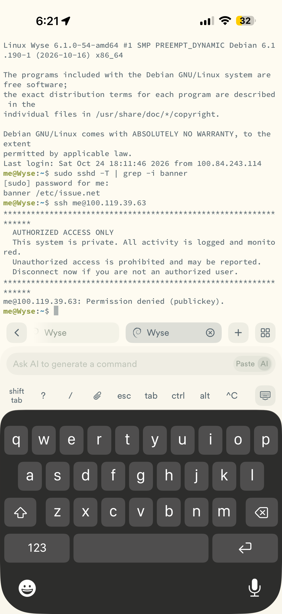
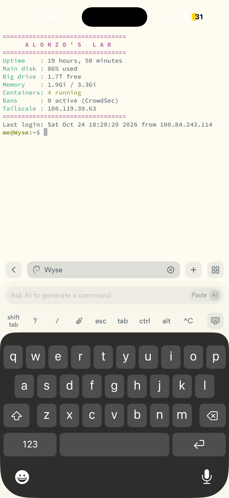

# SSH: Controlling the Wyse from My Laptop

**Beginner level:** still learning, documenting as I go.

## What it is (simple version)

**Analogy:** SSH is a secure remote control for the Wyse's terminal. Everything I type is encrypted on the way.

SSH (Secure Shell) lets me open a terminal on my laptop and control the Wyse over the network, encrypted. No monitor, keyboard, or cable swapping needed. Servers in real companies are managed this way.

**Why not just plug the laptop into the Wyse with HDMI?** Laptop HDMI ports only send video out, they can't receive it. SSH replaces the cable entirely.

## Status

- [x] One-time setup on the Wyse
- [x] First connection from the laptop (over Tailscale, fingerprint verified, see [log](disk-cleanup-and-ssh-log.md))
- [x] Hardening: SSH keys, password login disabled, root login disabled ([log](disk-cleanup-and-ssh-log.md))
- [x] SSH from my iPhone (Termius) over Tailscale, using its own key (Oct 23, 2026)
- [x] Legal warning banner shown before login (Oct 24, 2026)
- [x] Custom purple login screen with live lab stats (Oct 24, 2026)
- [x] Custom neofetch logo: AZ, Matrix rain, heart + bat (Oct 24, 2026)

## SSH from my phone (Oct 23, 2026)

**Analogy:** Giving my phone its own key to the front door, instead of copying my laptop's. If I lose my phone, I change one lock, not every lock.

Goal: control the Wyse from my phone anywhere (like at work), without turning password login back on.

1. In **Termius** → Keychain → generated a new **ED25519** key **on the phone**. The private key never leaves the phone.
2. Opened the key with **Edit** and copied only the **public key** (`ssh-ed25519 AAAA...`). I did **not** use "Share", which could send the private key, or "Export to host", which needs password login and I have that turned off.
3. Emailed the public key to myself. That's safe: a public key can't log anyone in by itself.
4. From my laptop, SSH'd into the Wyse and added it to the allowed keys:
   ```bash
    echo "ssh-ed25519 AAAA...phone-key" >> ~/.ssh/authorized_keys
   cat ~/.ssh/authorized_keys     # 2 lines now: laptop + phone
   ```
5. In Termius, added a host (Wyse's Tailscale IP, user `me`, ED25519 key), accepted the fingerprint, and got `me@Wyse:~$` on my phone.

**Why this is the secure way:** each device gets its **own** key. If my phone is lost, I delete just its line from `authorized_keys` and the laptop keeps working. That's **revocation**, and it beats sharing one key across devices.

**Extra hardening:** Termius app lock (Face ID), and never pasting secrets into the app's AI command bar.

---

## Legal warning banner (Oct 24, 2026)

**Analogy:** the "No trespassing, you're on camera" sign on the front door. It doesn't stop anyone by itself, but nobody can claim they didn't know. Companies are required to post one, which makes it a **GRC control** (it supports policy enforcement and legal action).

```bash
# 1. Write the sign
sudo tee /etc/issue.net > /dev/null <<'EOF'
*****************************************************************
  AUTHORIZED ACCESS ONLY
  This system is private. All activity is logged and monitored.
  Unauthorized access is prohibited and may be reported.
  Disconnect now if you are not an authorized user.
*****************************************************************
EOF
# 2. Tell SSH to show it (its own drop-in file, next to 10-hardening.conf)
echo "Banner /etc/issue.net" | sudo tee /etc/ssh/sshd_config.d/20-banner.conf
# 3. Proofread, then apply without dropping my session
sudo sshd -t && sudo systemctl reload ssh
# 4. Confirm what SSH is actually using
sudo sshd -T | grep -i banner      # banner /etc/issue.net
```

**Test, the attacker's view:** I ran `ssh me@<wyse-ip>` from the Wyse to itself, which has no key, just like a stranger. The banner appeared **before** login, then: `Permission denied (publickey)`. Warned, then blocked.



**Gotcha:** the Termius app on my phone doesn't display pre-login banners, so it *looked* broken there. `sshd -T` proved the server side was right. **Lesson:** check the server's real config before blaming it; sometimes it's the client.

**Undo:** `sudo rm /etc/ssh/sshd_config.d/20-banner.conf && sudo systemctl reload ssh`

## Custom login screen (Oct 24, 2026)

**Analogy:** the legal banner is the "No trespassing" sign *outside* the door. This is the **welcome board inside the lobby**: the moment I'm in, it shows the house's health at a glance.



Debian builds the login message (MOTD, "message of the day") by running every script in `/etc/update-motd.d/` in order. I added my own:

```bash
sudo tee /etc/update-motd.d/20-alonzo-lab > /dev/null <<'EOF'
#!/bin/bash
P='\033[1;35m'; C='\033[0;36m'; G='\033[0;32m'; N='\033[0m'
echo -e "${P}=================================${N}"
echo -e "${P}      A L O N Z O ' S   L A B    ${N}"
echo -e "${P}=================================${N}"
echo -e "${C}Uptime    :${N} $(uptime -p | sed 's/up //')"
echo -e "${C}Main disk :${N} $(df -h / | awk 'NR==2{print $5" used"}')"
echo -e "${C}Big drive :${N} $(df -h /mnt/agents 2>/dev/null | awk 'NR==2{print $4" free"}')"
echo -e "${C}Memory    :${N} $(free -h | awk '/Mem:/{print $3" / "$2}')"
echo -e "${C}Containers:${N} ${G}$(docker ps -q 2>/dev/null | wc -l) running${N}"
echo -e "${C}Bans      :${N} $(cscli decisions list -o json 2>/dev/null | grep -o '"value"' | wc -l) active (CrowdSec)"
echo -e "${C}Tailscale :${N} $(tailscale ip -4 2>/dev/null)"
echo -e "${P}=================================${N}"
EOF
sudo chmod +x /etc/update-motd.d/20-alonzo-lab   # make it runnable
sudo run-parts /etc/update-motd.d/               # preview it

# clean out Debian's default text (reversible)
sudo cp /etc/motd /etc/motd.bak && sudo truncate -s 0 /etc/motd   # the legal paragraph
sudo chmod -x /etc/update-motd.d/10-uname                         # the "Linux Wyse 6.1.0..." line
```

**Kept on purpose:** `Last login: ... from <IP>`. It's a mini security alert: a time or IP I don't recognize means someone else got in.

**It already paid off:** the first time it ran, it showed the main disk at **86%** (it was 79% the day before), so I caught the growth right away.

**Undo:** `sudo rm /etc/update-motd.d/20-alonzo-lab && sudo cp /etc/motd.bak /etc/motd && sudo chmod +x /etc/update-motd.d/10-uname`

## Custom logo with neofetch (Oct 24, 2026)

**Analogy:** the login screen above is the lobby's **health board** (how the house is doing). Neofetch is the house's **ID card**: what it's built from (OS, CPU, RAM), next to a logo. By default the logo is Debian's swirl, like the builder's stamp. I swapped in my own.

**What neofetch is:** a tiny program that prints system info next to ASCII art (pictures made of text characters). It's the classic homelab screenshot.

```bash
sudo apt install neofetch -y      # tiny, a few hundred KB
neofetch                           # shows the Debian logo + system info
```

**My own logo:** a text file of characters, where `${c1}`, `${c2}`, etc. are color slots:

```text
${c4}1  0   1 0   1  0  1   0 1  0
${c4}0  1     1   0     0   1    1
${c1}    _    _____  ${c4}1  0  1    0  1
${c1}   / \  |__  /  ${c4}0     0 1  1
${c1}  / _ \   / /   ${c4}1  1  1 0     0
${c1} / ___ \ / /_   ${c4}   0    1  1  1
${c1}/_/   \_\____|  ${c4}0  1  0    0
${c2} ALONZO'S LAB   ${c4}1     1 0  1  0

${c1} ,d88b.d88b,   ${c3} .       ^.^       .
${c1} 88888888888   ${c3} 8b.    d888b    .d8
${c1} `Y8888888Y'   ${c3} 888b..d88888b..d888
${c1}   `Y888Y'     ${c3} 8888888888888888888
${c1}     `Y'       ${c3} `Y8P' `Y888P' `Y8P'
${c3}                         V
${c4} here for a good time :)
```

Saved to `~/.config/neofetch/az.txt` (my own folder, so no `sudo`). Colors: `5` purple (AZ, heart), `6` teal (ALONZO'S LAB), `8` dark gray (bat), `2` green (Matrix-style rain + text). The rain is plain 1s and 0s on purpose: fancy Matrix symbols are double-width on some screens and break the alignment.

**Made it permanent:**
```bash
neofetch > /dev/null      # first run creates the settings file
sed -i 's|^image_source=.*|image_source="/home/me/.config/neofetch/az.txt"|; s|^ascii_colors=.*|ascii_colors=(5 6 8 2)|' ~/.config/neofetch/config.conf
echo 'neofetch' >> ~/.bashrc   # run it at the start of every session
```

**What `~/.bashrc` is:** a to-do list my account runs every time I open a terminal. **Analogy:** a morning routine. Adding `neofetch` to it is like adding "look at the house's ID card" to the routine.

**What I learned:**
- Text files + color codes = terminal art. Spacing matters because every character is the same width.
- Settings live in plain text files (`config.conf`). `sed` edits them without opening an editor.
- I iterated on the design (basketball, eye with a `$` pupil, comedy/tragedy masks, heart + bat) before settling. Cheap to change, because it's just a text file.
- I skipped turning a TV-show screenshot into the logo: it's someone else's copyrighted image. For a photo logo I'd use my own picture with a tool like `chafa`.

**Undo:** `sed -i '/^neofetch$/d' ~/.bashrc`

## One-time setup (on the Wyse, with a monitor)

1. Check if SSH is already running:
   ```bash
   systemctl status ssh
   ```
   `active (running)` = skip to step 3.
2. If it's not installed:
   ```bash
   sudo apt install openssh-server -y
   ```
3. Get the Wyse's local IP (the first one, starts with `192.168`):
   ```bash
   hostname -I
   ```
   Write it down. After this, the monitor can go back to the PC.

## Connecting (from the laptop, every time)

1. Laptop on the **same home Wi-Fi** (the Wyse being on ethernet is fine, same router).
2. Open **PowerShell** (Windows) or **Terminal** (Mac).
3. Connect:
   ```bash
   ssh me@<wyse-ip>
   ```
4. First time only: it asks `Are you sure you want to continue connecting?` → type `yes`.
5. Enter the Wyse password (nothing shows while typing, that's normal).
6. Seeing `me@Wyse:~$` = connected. Every command works like I'm at the Wyse.

**Disconnect:** `exit` (the Wyse keeps running).

**From outside the house:** turn on Tailscale on the laptop and use the Wyse's Tailscale IP (`100.x.x.x`) instead. See [tailscale.md](tailscale.md).

## Troubleshooting

**Analogy:** Each error is a different reason the door won't open: nobody home (refused), wrong address (timed out), wrong key (permission denied), or the house's ID card changed (host identification changed).

| Error | Meaning | Fix |
|---|---|---|
| `Connection refused` | SSH isn't installed or running on the Wyse | Redo setup step 2, then `sudo systemctl enable --now ssh` |
| `Connection timed out` | Wrong IP or laptop on a different network | Check Wi-Fi, recheck `hostname -I` on the Wyse |
| `Permission denied` | Wrong username or password | Username is `me`; retype the password slowly |
| `REMOTE HOST IDENTIFICATION HAS CHANGED` | The Wyse was reinstalled or its IP now points to a different device | Only if I know why: `ssh-keygen -R <wyse-ip>`, then reconnect |

## Rules over SSH

**Analogy:** Don't saw off the branch you're sitting on. A network or firewall change can cut the very connection you're using to make it.

- Don't run `reboot`, network changes, or firewall changes unless I mean it. If the network drops, I lose the connection and need the monitor again.
- Follow the production rules in [wyse-safety-net.md](wyse-safety-net.md).
- Never open port 22 on the router to the internet. Use Tailscale for remote access.

## Optional: see the desktop remotely

If I want the XFCE desktop on the laptop instead of just a terminal, install `xrdp` on the Wyse and connect with Windows' built-in **Remote Desktop Connection** app. Heavier than SSH, but shows the full screen.

## Next: hardening (later)

- Set up **SSH keys** so I log in without a password
- Then **disable password login** in `/etc/ssh/sshd_config`
- Keep a second SSH session open while changing SSH settings, so a mistake doesn't lock me out

## What I learned

- SSH runs on **port 22** and encrypts everything, including the password
- Servers are usually "headless" (no monitor) and managed remotely
- Exposing SSH to the internet is a top attack target, so remote access goes through a VPN like Tailscale instead
