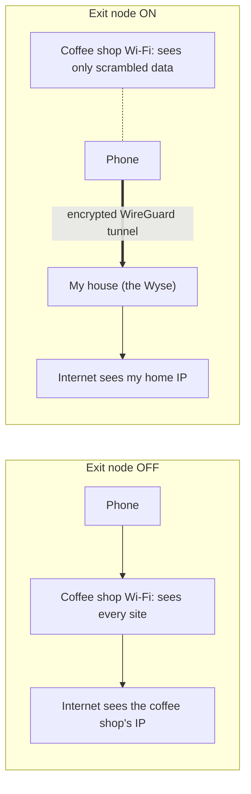
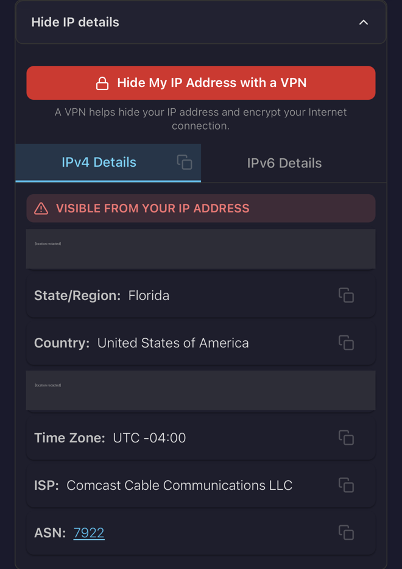
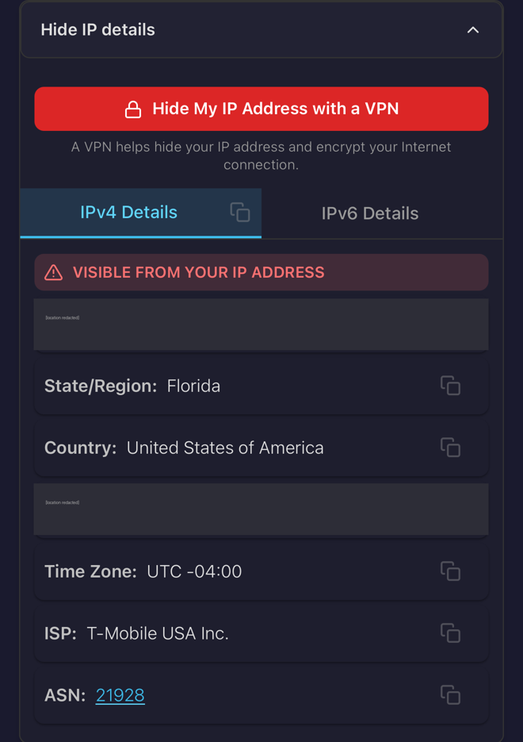

# Tailscale

**Beginner level:** still learning, documenting as I go.

## What it is (simple version)

**Analogy:** A private, encrypted tunnel connecting all my devices, wherever they are. Only my devices can enter it, and nobody outside can see in.

Tailscale creates a **private, encrypted network** between my devices, no matter where they are. My phone on cellular data can reach my home server like it's sitting next to it.

It's a VPN, but much easier than a traditional one. No opening ports on my router and no complicated setup. Every device logs in with my account, gets its own private IP (starting with `100.`), and they can all talk to each other securely.

## Visual: Exit node off vs on

**Analogy:** Off: my traffic goes straight out through whatever Wi-Fi I'm on. On: everything rides an encrypted tunnel home first, so the Wi-Fi owner only sees scrambled data.



## Why it matters for security

**Analogy:** Instead of cutting a door in the house that faces the street (port forwarding), I built a secret tunnel only my devices know about. Nothing for strangers to knock on.

- **No port forwarding:** I don't expose my home server to the open internet, which is a big attack surface reduction
- **Encrypted:** traffic between devices uses WireGuard encryption
- **Identity-based access:** only devices logged into my account can join

## My setup

- **Server:** Dell Wyse 5060 is connected to my tailnet
- **Exit node:** the server is set up as an exit node, so my phone can route its traffic through my home network on public Wi-Fi
- **Other devices:** a few phones (some are old and need to be removed)

## Useful commands

```bash
sudo tailscale status    # list devices and whether they're online
sudo tailscale up        # connect (or reconnect) the server
sudo tailscale ip        # show this device's Tailscale IP
```

## Current status

**Analogy:** The tunnel works, the exit node works, and I check the guest list (asset inventory) so no stranger's device sneaks into the tunnel.

- ✅ Server connected and online
- ✅ Reached Pi-hole from my phone through Tailscale ([log](remote-access-log.md))
- ⚠️ If the Wyse is offline while the exit node is on, my phone's internet is blocked (kill switch). Fix: disable the exit node in the app
- ✅ IP forwarding enabled (`/etc/sysctl.d/99-tailscale.conf`), health warning gone
- ✅ **Exit node approved and tested (Oct 22, 2026).** On cellular, whatismyip.com showed ISP **Comcast** (my home internet) with the exit node on, and **T-Mobile** (my carrier) with it off. Traffic really does leave through my house

| Exit node **ON** | Exit node **OFF** |
|---|---|
|  |  |
| ISP: **Comcast** (my home internet) | ISP: **T-Mobile** (my phone carrier) |

*Location fields and IPs redacted.*

- ⚠️ Exit node is noticeably slower: traffic is limited by home upload speed and the 2.4GHz extender. I only turn it on for public Wi-Fi
- ✅ **Asset inventory reviewed (Oct 22, 2026):** the two older iPhones that showed "offline, last seen 138d/163d ago" are back in use, so I reconnected them instead of removing them. All 5 devices (Wyse, laptop, 3 iPhones) are now active and using Pi-hole over Tailscale. Any device I stop using gets removed

## MagicDNS: names instead of IPs (Oct 24, 2026)

**Analogy:** saving a contact as "Mom" instead of memorizing her number. Same phone, same person, easier to remember.

Tailscale gives every device on my tailnet a name. `tailscale status` shows them (second column), and the full name is in `tailscale status --json | grep -m1 DNSName`:
- Short name: `wyse`
- Full name: `wyse.<tailnet>.ts.net`

Now `http://wyse:3000` (dashboard), `http://wyse:3001` (Uptime Kuma), and `ssh me@wyse` all work from any device on my tailnet. No more typing `100.x.x.x`.

**Gotcha: Homepage said "Host validation failed."** MagicDNS worked fine. Homepage was protecting itself. Its `HOMEPAGE_ALLOWED_HOSTS` setting only listed the IP-based addresses, so a request for "wyse" got refused. **Analogy:** a doorman with a guest list. I showed up under a nickname he'd never heard, so we added the nickname to the list. See [homepage.md](homepage.md).

## What I learned

- **Proving a VPN works:** check your public IP's ISP with the VPN on vs. off. Location lookups are often wrong (mine said the wrong city), but the ISP name is reliable


- "Idle" in `tailscale status` just means no traffic right now, not broken
- "Offline, last seen Xd ago" means that device isn't running Tailscale
- Old, unused devices on your network are a security risk, so you should regularly review what's connected. That's **asset inventory**, a core security control
