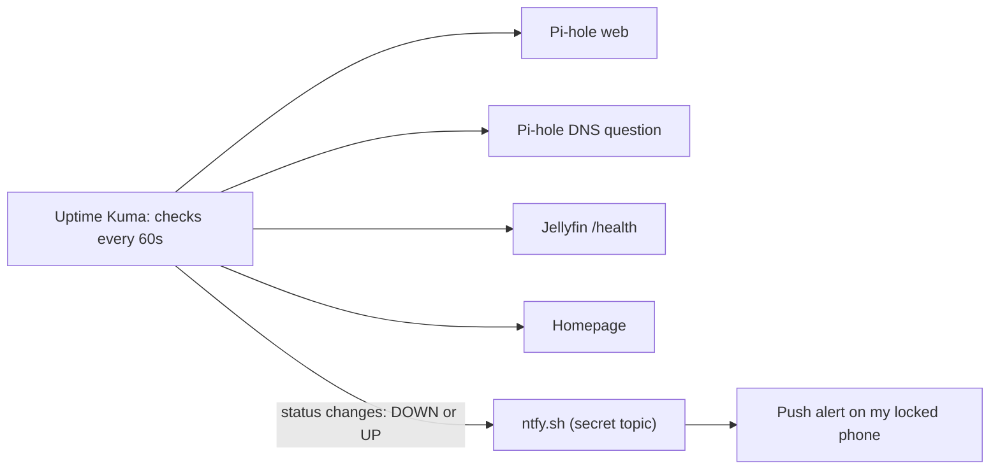

# Uptime Kuma: Monitoring My Lab

**Beginner level:** still learning, documenting as I go.
**Set up:** Oct 23, 2026, entirely from my phone (SSH in Termius + Safari over Tailscale)

## What it is (simple version)

Uptime Kuma checks every service in my lab every 60 seconds and records whether it answered. Green bar = up, red bar = down.

**Analogy:** a security guard doing rounds, knocking on every door once a minute and writing down who answered.

**Why I added it:** when Pi-hole vanished after a reboot ([log](pihole-docker-recovery-log.md)), I only found out because ads came back. With monitoring, I'd know within a minute.

## Visual: How monitoring + alerts work

**Analogy:** The guard knocks on every door each minute. If one doesn't answer, he radios my phone; when it's back, he radios again.



## Install

**Analogy:** Hiring the security guard and giving him a notebook (the database on the big drive). He can look at doors but gets no master keys (no Docker socket).

Config in `/opt`, data on the big drive (same pattern as my other services):

```bash
sudo mkdir -p /opt/uptime-kuma /mnt/agents/uptime-kuma
sudo tee /opt/uptime-kuma/docker-compose.yml > /dev/null <<'EOF'
services:
  uptime-kuma:
    image: louislam/uptime-kuma:2
    container_name: uptime-kuma
    restart: unless-stopped
    ports:
      - "3001:3001"
    volumes:
      - /mnt/agents/uptime-kuma:/app/data
EOF
cd /opt/uptime-kuma && sudo docker compose up -d
```

Then I opened the web UI on port 3001 over Tailscale, chose **SQLite** (lightest database, right for a thin client), and created an admin account with a strong password.

**Security choice: no Docker socket.** Many guides mount `/var/run/docker.sock` into the container. That would give Uptime Kuma control over *every* container on the server. It only needs to *see* whether services answer, so I left it out. That's **least privilege**.

## My monitors

| Monitor | Type | What it checks | Analogy |
|---|---|---|---|
| Pi-hole Web | HTTP | Dashboard page returns `200 OK` | Does the store's front door open? |
| Pi-hole DNS | DNS | Asks Pi-hole to resolve `google.com` on port 53 | Walk in and actually **buy something**. Proves the cashier *and* the stockroom work |
| Jellyfin | HTTP | Jellyfin's built-in `/health` endpoint | Ask the theater manager "you open?" |
| Homepage | HTTP | Dashboard loads | Is the lobby directory still on the wall? |

**Why the DNS monitor matters most:** the Pi-hole web page can be up while DNS is broken. A real DNS query tests the whole chain, **Pi-hole → Unbound → root servers**, so it also covers Unbound (which only listens on localhost and can't be checked directly from a container).

## Troubleshooting

**Analogy:** The guard was marking a door as dark because he didn't trust its fake-looking ID (self-signed cert), and couldn't call a phone number with a typo in it (the resolver box).

| Problem | Cause | Fix |
|---|---|---|
| Pi-hole Web: `self-signed certificate in certificate chain` | I typed `https://`. Pi-hole v6 serves HTTPS with a **self-signed cert** no Certificate Authority vouches for, so Uptime Kuma refused it | Switched the URL to `http://`. Traffic is still encrypted by Tailscale (WireGuard) |
| Pi-hole DNS: `None of the configured resolver servers could be resolved to an IP address` | The Resolver Server field had extra text in it, not a clean IP | Cleared the field and typed only the IP; port goes in its own box (`53`) |

Low uptime percentages right after setup are just those early red checks. They climb to ~100% on their own.

## Security concepts

- **Availability** (the A in the CIA triad): monitoring is how you *prove* a service is available, not just hope it is
- **Continuous monitoring**: a core control in NIST CSF (Detect) and CIS Controls
- **PKI / chain of trust**: why self-signed certs fail validation by default
- **Least privilege**: no Docker socket
- **Known gap:** if the whole Wyse goes down, Uptime Kuma goes down with it and can't alert ("who watches the watchman"). Fix later: a second monitor on a different device

## Phone alerts (ntfy)

Uptime Kuma pushes an alert to my phone when any monitor goes **down**, and again when it **recovers**.

**Analogy:** the security guard now has a walkie-talkie. Instead of me checking his notebook, he radios me the moment a door doesn't answer.

1. Made a random topic name on the Wyse:
   ```bash
   echo "wyse-$(openssl rand -hex 8)"
   ```
2. **ntfy** iPhone app: **+** → subscribed to that topic on `ntfy.sh` → allowed notifications
3. **Uptime Kuma** → Settings → Notifications → Setup Notification:
   - Type: **ntfy** (not "Notify!", which is a different app; I picked it by mistake first)
   - Server URL: `https://ntfy.sh`, Topic: the same random name
   - **Default enabled** + **Apply on all existing monitors** on
4. **Test** → phone buzzed

**Why the topic is random (and not in this repo):** the free ntfy server is public. Anyone who **guesses** a topic name can read those alerts or send fake ones. A long random name works like a password. Fake "all clear" alerts would be a real attack on a monitoring system, so the topic is treated as a **secret**.

**Troubleshooting the alert:** the **Test** button buzzed my phone, but stopping Jellyfin didn't. I worked through the alert chain one link at a time:

| Link | Test | Result |
|---|---|---|
| ntfy server → phone | `curl -d "test from wyse" ntfy.sh/<topic>` from the Wyse | ✅ Buzzed |
| Uptime Kuma → ntfy | **Test** button in the notification settings | ✅ Buzzed |
| Monitor → alert | `sudo docker logs uptime-kuma --tail 30` | ❌ Found retries holding it in Pending |
| Alert attached to monitor? | Each monitor's Edit → Notifications | ❌ Phone was off on all 4 |

The logs showed `Failing: connect ECONNREFUSED ...:8096 | Down Count: 0`. Uptime Kuma *saw* Jellyfin was off (connection refused), but the monitor's **retries** kept it in **Pending** (orange), so it never officially went **DOWN** and never alerted. Retries exist to prevent false alarms from one blip. I set **Retries = 1** and **Retry Interval = 60s**, which means an alert in about 2 minutes. That's a balance between **alert fatigue** and **detection speed**, a real SOC tuning decision.

**Second root cause:** even after fixing retries, the monitor went DOWN (logs confirmed it) but still no alert. I opened each monitor's **Edit → Notifications** section, and **Phone was OFF on all 4**. "Apply on all existing monitors" never took effect, probably because I toggled it after the first save. The alert existed but wasn't attached to anything, like installing a fire alarm and never wiring it to a room. I turned Phone on for every monitor.

**Lesson:** a successful **Test** only proves the notification channel works. It doesn't prove any monitor actually *uses* it. Always verify with a real failure.

**Bonus finding in the same logs:** `[AUTH] Successfully logged in user ... IP=<my iPhone's Tailscale IP>`. That's an **authentication log** showing who logged in and from where. A login from an IP I don't recognize would be a red flag.

**Fire drill:** stopped a container on purpose (`sudo docker stop jellyfin`) to prove alerts work end to end, then started it again (`sudo docker start jellyfin`). Testing your alerting by breaking something on purpose is how real ops/SOC teams validate it.

**✅ Fire drill passed (Oct 23, 2026, ~9 PM):**
- `docker stop jellyfin` → about 2 minutes later: **🔴 Jellyfin Down**, `connect ECONNREFUSED`
- `docker start jellyfin` → about 1 minute later: **🟢 Jellyfin Up**, `200 - OK`, delivered to my **locked** phone

Alerts don't need Tailscale on the phone. They travel Wyse → ntfy.sh → Apple push → phone, like any app notification.

## Phone access

Saved to my iPhone home screen (Safari → Share → Add to Home Screen). It opens full-screen like an app. Requires Tailscale on.

## Next steps

- [x] Phone push alerts with ntfy
- [ ] Add an Uptime Kuma tile to my [Homepage](homepage.md) dashboard
- [ ] Second monitor on another device to watch the Wyse itself
