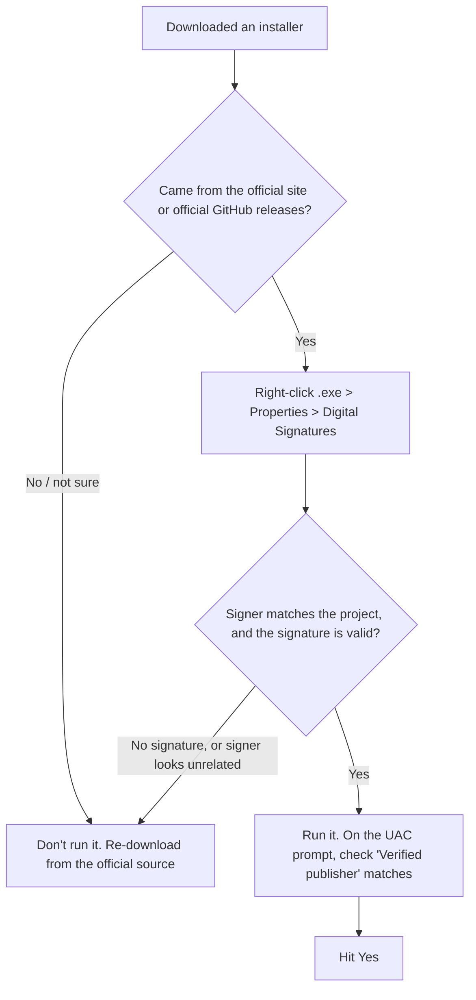

# Verify Before You Run: Checking an Installer Is Legit

**Beginner level:** still learning, documenting as I go.
**Written:** Oct 25, 2026

## What it is (simple version)

Before I let any `.exe` install with admin rights, I check two things: **who signed it** and **where I got it**. A Windows UAC prompt ("Do you want to allow this app to make changes to your device?") is the last checkpoint before a program gets full control of my PC.

**Analogy:** A digital signature is the tamper-proof seal on a medicine bottle. It proves nobody opened the bottle after the factory sealed it. It does **not** prove I bought it from a real pharmacy. That's why the download source matters too.

## Visual: The two checks

**Analogy:** Two locks on the same door. The seal check (signature) and the store check (download source) both have to pass before I hit Yes.



## The habit (step by step)

1. **Download only from the official source.** The project's own website or its official GitHub **Releases** page. No mirror sites, no "free download" sites, no random links.
2. **Check the signature before running.** Right-click the `.exe` > **Properties** > **Digital Signatures** tab. Confirm the signer matches who should have made it, then click **Details** and make sure it says the signature is OK.
3. **Read the UAC prompt.** Look at **Verified publisher**:
   - ✅ A real name that makes sense for the app
   - 🚩 **Publisher: Unknown** (unsigned file)
   - 🚩 A signer that has nothing to do with the app
4. **Optional deeper check:** on the UAC prompt, tap **Show more details** > the certificate link, and confirm the cert is valid and not expired.
5. **Extra credit:** if the project publishes a SHA-256 hash, compare it in PowerShell:

```powershell
Get-FileHash .\installer.exe -Algorithm SHA256   # compare against the hash on the official page
```

## Real example: Rainmeter (Oct 25, 2026)

**Analogy:** The seal said "packed by a trusted pharmacy that handles this exact brand," and the label matched the brand's real address. Both checks passed.

- File: `Rainmeter-4.5.28.3936.exe`
- UAC showed the official repo: `github.com/rainmeter/rainmeter`
- **Verified publisher: SignPath Foundation.** SignPath is a nonprofit that code-signs open-source projects, and Rainmeter uses it. So a signer name that isn't "Rainmeter" was still expected here. That's the point of checking: know *who should* sign it, not just *that* it's signed.
- Result: ✅ legit, allowed

## Why it matters for security

**Analogy:** Attackers love dressing malware up as popular free apps, the same way a scammer copies a real store's sign. Checking the seal and the store is how I catch the fake.

- **Supply chain attacks:** fake or trojanized installers are a classic way malware gets in
- **Code signing:** proves **integrity** (not modified) and **authenticity** (who made it)
- **UAC:** a guardrail for **least privilege**. Admin rights only when I approve it
- **Security+ SY0-701** tie-ins: code signing, supply chain risk, hashing for integrity, least privilege

## Quick checklist

- [ ] Downloaded from the official site / official GitHub releases
- [ ] Digital Signatures tab shows a valid signature
- [ ] Signer makes sense for this app
- [ ] UAC "Verified publisher" matches
- [ ] (Optional) SHA-256 hash matches the official one
