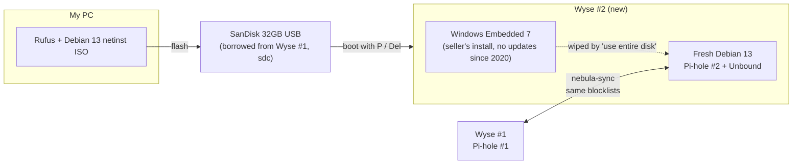

# Wyse #2 Setup Log (Backup Pi-hole)

**Date:** Oct 27, 2026
**Goal:** Turn the second Dell Wyse 5060 into **Pi-hole #2**, a backup DNS server synced with Pi-hole #1 using nebula-sync. Full plan: [lab expansion](lab-expansion-plan.md).

> **Analogy:** Pi-hole is the bouncer at the club door, checking every website request. Right now I have one bouncer. If he goes on break (the Wyse reboots or crashes), the door is unguarded and the internet breaks for everyone using it. Wyse #2 is the second bouncer, with the same guest list so either one can work the door.



## What I found

| Finding | What it means |
|---|---|
| Wyse #2 booted into **Windows Embedded Standard 7** | Not Debian. Old OS with no security updates since 2020. Don't log in or browse on it; it gets wiped. |
| BIOS and boot menu keys on the 5060 | **P** = boot menu, **Del** = BIOS. Default Dell Wyse BIOS password: `Fireport`. (F12/F2 are for newer Wyse models.) |
| Wyse Windows has a **write filter** | Changes get thrown away on reboot (like a hotel room that resets every night). Another reason to wipe it instead of installing from inside Windows. |
| I only have **one Ethernet cable**, and it's Wyse #1's | Unplugging Wyse #1 takes Pi-hole offline. Borrow the cable only after setting a DNS fallback (below). |

## The USB stick

I didn't need to buy one. My **SanDisk Ultra 32GB (USB 3.0)** from May was already plugged into Wyse #1. I checked whether it was in use before pulling it:

```bash
lsblk -o NAME,SIZE,MOUNTPOINT,LABEL
```

| Device | Size | Mounted at | What it is |
|---|---|---|---|
| `sda` | 7.5G | `/` + swap | Wyse #1's own system drive (small, so watch `df -h /`) |
| `sdb1` | 1.8T | `/mnt/agents` | Big external drive: Jellyfin media + agents. **Never touch.** |
| `sdc1` | 28.7G | *(blank)* | The SanDisk. **Not mounted, so it's safe to pull.** |

**Rule:** a blank MOUNTPOINT means nothing is using it. If it shows a path, check what's on it and `umount` it first.

One USB is enough. The installer is reusable (like a key that opens as many doors as I want), so the same stick works for the OptiPlex.

## Borrowing the Ethernet cable safely

1. Tailscale admin, then **DNS**: add `1.1.1.1` as a backup nameserver, or turn off "Override local DNS" for now.
2. If the router hands out Pi-hole as DNS, set it back to automatic for now.
3. Give my mom a heads up (her phone uses my Pi-hole).
4. Move the cable to Wyse #2 and do the install (about 20 to 30 minutes).
5. Move the cable back to Wyse #1 and undo steps 1 and 2.

**Real fix:** buy a second Cat6 cable (about $5). If the extender has only one port, also get a 5-port unmanaged switch (about $15 to $20). Wyse #2 has to stay plugged in for good.

## Install steps

1. **On the PC:** download **Debian 13 netinst amd64** from debian.org and **Rufus** from rufus.ie. Flash the SanDisk (ISO mode).
2. **On Wyse #2:** plug in the USB, power on, tap **P** (or **Del**, then set the USB as the boot device). Choose **Install** (not Graphical).
3. **Installer settings:**
   - Hostname: `wyse2`
   - Username: `me`
   - Partitioning: **use entire disk** (this also wipes the old government drive data, per NIST SP 800-88)
   - Software: uncheck the desktop. Check only **SSH server** and **standard system utilities**.
4. **Router:** set up a DHCP reservation for `wyse2` so its IP never changes.
5. **SSH key** (from PowerShell on my PC):
   ```powershell
   type $env:USERPROFILE\.ssh\id_ed25519.pub | ssh me@<wyse2-ip> "mkdir -p ~/.ssh && cat >> ~/.ssh/authorized_keys"
   ```
   Then turn off password logins and add a key for Termius.
6. **Tailscale + Docker:**
   ```bash
   curl -fsSL https://tailscale.com/install.sh | sh
   sudo tailscale up
   curl -fsSL https://get.docker.com | sh
   sudo usermod -aG docker me
   ```
7. **Next session:** Pi-hole #2 + Unbound, then nebula-sync.

## Status

- [x] Got Wyse #2, booted it, and identified the old OS
- [x] Found a USB stick and confirmed it's safe to pull from Wyse #1
- [ ] Flash Debian 13 to the USB
- [ ] Install Debian on Wyse #2
- [ ] Second Ethernet cable (+ switch if needed)
- [ ] Pi-hole #2 + Unbound + nebula-sync
